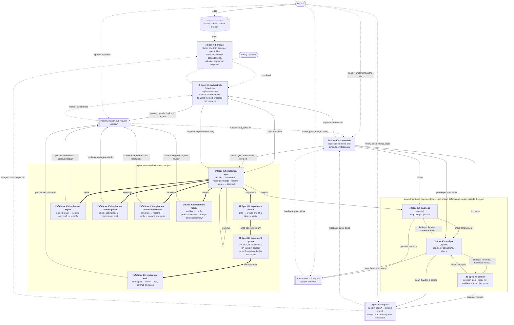

# Spec Kit workflows

The `speckit-*` workflows take a Spec Kit feature folder under `specs/` from a twin issue to a merged implementation.
They run from the default branch and decide from the state on GitHub (issues, labels, pull requests, check runs),
so a run can be repeated or replaced safely.

## Overview



Edges: dotted arrows are GitHub events that trigger a workflow, solid arrows are workflow dispatches or effects on a
pull request, and thick arrows are reusable workflow calls (`workflow_call`) that run inside the caller's run.
Marks: 🤖 runs AI (Copilot CLI or an agentic workflow), ⚙ is script only, and ✍ receives command guidance (see
[Where AI runs and where guidance applies](#where-ai-runs-and-where-guidance-applies)).
Implementation pull requests stay draft while the chain is working, stopped for a decision, or waiting for a diagnosis.
They become ready only after final verification, immediately before an automatic merge or an intentional review handoff.

## Workflows

| Workflow | File | Triggered by | Does |
| --- | --- | --- | --- |
| Spec Kit prepare | [speckit-prepare.yml](speckit-prepare.yml) | Push to `specs/**`, stage label changes (restored when a person made them), manual | Keeps one twin issue per spec folder, infers dependencies between new twins, validates implement requests; a dispatched, applying run then dispatches `Spec Kit orchestrate`. |
| Spec Kit orchestrate | [speckit-orchestrate.yml](speckit-orchestrate.yml) | Prepare completed, twin closed or reopened, `speckit/*` pull request closed or pushed, dispatched by every automatic merge and every dispatched, applying prepare run, twice an hour as a fallback, manual | Starts implementation chains up to `SPECKIT_MAX_ACTIVE_SPECS` (default 3; requested twins that block running implementations start regardless and first), restarts broken chains, finalizes merged implementations, settles amendments and spec pull requests authored by `/speckit author`, blocks running implementations whose twin has open blocked-by twins, and lifts the block and retries once they are implemented. Events caused by the workflow token (an automatic merge, the twin it closes) start no workflows except dispatches, so the explicit dispatches are the main path after a merge. |
| Spec Kit implement spec | [speckit-implement-spec.yml](speckit-implement-spec.yml) | Orchestrate, itself, commands | One per run: a phase, a guided repair, the convergence, a conflict resolution, or the merge; then dispatches its next run. |
| Spec Kit implement phase | [speckit-implement-phase.yml](speckit-implement-phase.yml) | Implement spec (`workflow_call`) | Plans one phase's ordered units and calls the group workflow for them serially; verifies the phase after its last unit. |
| Spec Kit implement group | [speckit-implement-group.yml](speckit-implement-group.yml) | Implement phase (`workflow_call`) | Calls the single-task workflow once for a singleton or in parallel for consecutive `[P]` tasks. A multi-task group is verified together (affected tests of the group's changes) only when a landing had to merge a sibling's edits to the same files; otherwise each task's own verification and the phase verification cover it, and the report only shows the next unit. Singleton groups add no duplicate work. |
| Spec Kit implement task | [speckit-implement-task.yml](speckit-implement-task.yml) | Implement group (`workflow_call`) | Implements and verifies exactly one task, then validates, ticks, commits, pushes, and reports that task through a write-isolated landing job. |
| Spec Kit implement repair | [speckit-implement-repair.yml](speckit-implement-repair.yml) | Implement spec (`workflow_call`) | Applies writer-approved diagnosis guidance to an already-landed verification failure, lands the repair without changing `tasks.md`, and resolves its durable repair state only after reverification passes. |
| Spec Kit implement convergence | [speckit-implement-converge.yml](speckit-implement-converge.yml) | Implement spec (`workflow_call`) | Runs `/speckit-converge` against the completed implementation with the strong model, validates the tasks-only result, then commits and pushes it. |
| Spec Kit implement conflict resolution | [speckit-implement-resolve.yml](speckit-implement-resolve.yml) | Implement spec (`workflow_call`) | Integrates the base branch, lets Copilot resolve unprotected conflicts when needed, runs final verification, then validates, commits, and pushes the resolution. |
| Spec Kit implement merge | [speckit-implement-merge.yml](speckit-implement-merge.yml) | Implement spec (`workflow_call`) | Archives the spec, builds and verifies the prospective merged tree with a read-only token, then squash-merges the pull request or deliberately hands it to a person for review. |
| Spec Kit commands | [speckit-commands.yml](speckit-commands.yml) | Pull request comments, reviews, and events | Handles `/speckit` commands (`retry`, `sync`, `author`, and `implement` on twin issues, `help`) and feedback on amendments and authored spec pull requests; keeps Spec Kit pull requests out of stacks. |
| Spec Kit diagnose | [speckit-diagnose.md](speckit-diagnose.md) ([lock](speckit-diagnose.lock.yml)) | Implement spec, analyze | Automatically explains why an implementation stopped and recommends one ready-to-post command that fits the category, chosen from the "Commands you can recommend" reference its evidence generates from `PR_COMMANDS`; for spec artifact defects opens and reworks an amendment pull request. |
| Spec Kit author | [speckit-author.yml](speckit-author.yml) | Commands (`/speckit author`), analyze | One decision step (reuse, refuse, or a feature description), then the Spec Kit workflow `author` unattended to author an ordinary spec for a cause outside the stopped spec and propose it against the default branch (one cause, one spec); reworks it after findings or feedback from the stage they concern. A consistent spec pull request is merged automatically unless it changes `docs/architecture/` (with a **Design decisions** comment from its plan) or a person pushed to it. |
| Spec Kit analyze | [speckit-analyze.md](speckit-analyze.md) ([lock](speckit-analyze.lock.yml)) | Diagnose, author, commands | Runs a read-only `/speckit-analyze` of the amended spec folder or the new spec and decides between a correction round, a rework, or human review. |

The six implementation work entry points use typed command scripts (`speckit-task.mjs`, `speckit-group.mjs`,
`speckit-repair.mjs`, `speckit-converge.mjs`, `speckit-resolve.mjs`, and `speckit-merge.mjs`). Attempt accounting,
result artifacts, verdicts, and landing stay shared
in `speckit-implement-work.mjs`. Common Actions
script plumbing—GitHub client construction, step summaries, and outputs—lives in `speckit-script-runtime.mjs`.
Git runners, optional-file readers, and link contexts remain local because their buffer, error, or missing-value
contracts differ.

## Units of work

- **Spec:** one feature folder under `specs/`, one twin issue, one `speckit/<folder>` branch, and one implementation
  pull request.
- **Phase:** a `##` heading of the spec's `tasks.md`.
- **Group:** one ordered phase unit: either one task or consecutive `[P]` tasks under one heading.
- **Task:** one checkbox line of `tasks.md`. Groups run serially; the tasks of a multi-task group run in parallel. A
  landing that has to merge a sibling's edits to the same files three-way names them in its commit message
  (`Combined with parallel changes to …`); only then are the group's changes verified together, with their affected
  tests. Measured on the implementation pull requests up to #179, a full verification after every multi-task group
  cost about three times the critical-path time that parallelism saved, and none of its failures came from the parallel
  tasks interacting; the phase verification catches the same failures.

Each run of Spec Kit implement spec does one of these: a phase, a guided repair, the convergence
(`/speckit-converge`), a conflict resolution, or the merge. A failed verification of already-landed code records
durable repair state without unticking tasks. Diagnosis recommends `/speckit retry <guidance>`; after a writer approves
it, repair work lands through a write-isolated job and the failed scope must pass reverification before normal planning
continues. For pending repairs, `/speckit retry` without guidance reverifies without a repair
agent; with guidance it runs the repair
agent, and a successful no-change result reaches reverification without creating an empty commit. Agent failures and
invalid or out-of-scope patches remain failures. Every failed repair attempt stops for a person, and every restart
(`/speckit retry`, a merged amendment, or implemented blockers) gets a fresh repair attempt; the
[unchanged-restart guard](#retry) keeps restarts from looping. Every unresolved implementation stop starts a diagnosis;
while it runs, the stop comment links to the diagnosis workflow so a person can inspect its progress. A reported
diagnosis then waits for its recommended action instead of being started again, unless the automation continues by
itself (see [Automatic continuation](#automatic-continuation)).
A task's agent leaves `tasks.md` alone: after the verification passed, the land job checks exactly that task's box
(an agent's own correct tick is still accepted, any other change of `tasks.md` is refused).
The verification reruns failing tests once: a .NET test project with at most 10 failed tests reruns only those, and
the Web UI browser tests run with `--retries=1`. A test that passes on the rerun lets the check pass but is reported as
**flaky** in the comment (marker `speckit-implement:flaky`); a test that fails twice fails the check. After each
scheduler run, a test that was flaky in `SPECKIT_FLAKY_THRESHOLD` (repository variable, default 3) implementation pull
requests within 14 days gets one `/speckit author` run, started on the latest open implementation pull request where
it was flaky (marker `speckit-implement:flaky-spec`) and without blocking it; the spec makes the test deterministic
and is implemented once someone signs it off with `/speckit implement` on its twin.
Reverification uses the original failure artifact's changed files together with repair changes, not just the diff since
the failed head. Missing or empty original scope falls back to full (`finalize`) verification. Downloaded evidence is
readable by the repair agent inside its workspace at the locally ignored `.speckit-repair-evidence/`; unavailable
artifacts do not weaken verification. The verification action must actually succeed, and the verified commit must still
be the pull request head, before the marker can resolve; verification-only work uses the decision's pinned head.
The comment commands that restart, synchronize, or fix a stopped implementation are described in
[Comment commands](#comment-commands). The chain keeps its branch current with the base branch by pulling: every run starts with
the job `sync` ("Merge the base branch"), which merges the base branch into the implementation branch through the
GitHub API when it is ahead and the next work is a phase that has not started (none of its tasks is ticked yet), the
convergence, or the merge (repository variable `SPECKIT_SYNC_BASE`, default `true`). Retries (`/speckit retry`),
merged amendments, retries after implemented blockers, and continuations of a started phase keep its base. On a conflict the
decide job of the same run starts the conflict resolution the merge uses (Copilot CLI edits the conflicted files and,
to fix clashes without a textual conflict such as two migrations with the same number, the implementation branch's
own files and new files; never protected paths or the environment actions; the full verification runs), and
the next run does the work on the merged branch. When the merged result can only pass with a change to a file that
only the base branch owns (for example a test the base branch added that does not know a setting this implementation
made required), the resolution may make the smallest such change, but never delete such a file or weaken a test. The
land job finds these files itself while it replays the resolution, lists them with their diff against the base branch
in the resolution comment (marker `speckit-implement:base-owned`), and the final merge then waits for a person's
review instead of merging automatically.
Conflicts under `specs/` never wait for a person and need no agent when the archive caused them: both the branch (which
archives its own spec before the merge) and the base branch (which archived other specs meanwhile) rewrite references
to archived specs, often on the same lines. Every base merge (the job `sync`, the conflict resolution, the merge's
archive step, and the land job's replay) first resolves them with the archive script (`resolveSpecConflicts` in
`speckit-archive.mjs`): outside the implementation's own spec folder it takes the base branch's version and applies
every archive to it; in the own folder it normalizes both sides and their merge base with every archive and merges them
three-way. After every such merge, also without conflicts, the script points references in all files to every archived
spec, for example in a spec the base branch added that links to the spec this branch archived. Only conflicts that
remain go to Copilot: code, and real edits of the own spec's artifacts that the base
branch changed too. Copilot may resolve the latter if it keeps every task and every checked box (the land job checks
`tasks.md`), and the final merge waits for a person's review of them. Outside the own spec folder an implementation may
change files under `specs/` only by reference rewrites: the merge verification refuses any other difference from the
base branch (`referenceOnlySpecChanges`). Conflicts under `.github/` and `.specify/` still need a person.
Before a phase or the convergence,
this is best effort: when GitHub refuses the merge, the conflicts touch protected paths, or the resolution fails
`MAX_SYNC_RESOLVE_ATTEMPTS` times, the implementation continues on its current base without stopping, that base commit
is recorded as skipped and not tried again, and the merge at the
end integrates it. Before the merge it is required, as the merge's own
conflict resolution. Nothing reacts to pushes to the base branch during a started phase. The workflow token may push these merges
even when the base branch changed workflow files, because they only bring in commits the repository already has. Job
names say what a job does, without step numbers; GitHub shows their order. The convergence starts with the `gha` extension's `before_converge` hook
`/speckit-gha-drift`, which checks `docs/architecture/` against the implementation; each stale, missing, or
contradicting statement becomes a convergence task, so the architecture is corrected before the merge. The hook comes
from the implementation branch, so a branch created before it existed gets it with the next merge of the base branch.

The merge workflow first archives the spec to `specs/archive/<folder>` on the implementation branch (job `archive`),
so the archive lands with the implementation. The controller runs only one of its `phase`, `repair`, `converge`,
`resolve`, or `merge` reusable jobs, so the others
always show as skipped. Prepare, orchestrate, and implement spec also have a `refuse` job that only runs, and fails, when
started from a branch other than the default branch.

## Comment commands

People with write access steer a stopped or running implementation by commenting on its implementation pull request
(`speckit/<folder>`); the command must be the first word of the comment, and `Spec Kit commands` handles it. Amendment
pull requests (`speckit-amend/<folder>`) and spec pull requests authored by `/speckit author` (`speckit-spec/<folder>`) need no commands: merge one
to apply it, comment or review it (*Comment* or *Request changes*) to have it reworked, or close it to discard it.

`PR_COMMANDS` in `.github/scripts/speckit-implement-core.mjs` is the single source of the commands, their flags, and
the diagnosis categories they fit. The table below, the reply to `/speckit help`, and the command reference in every
diagnosis evidence file are generated from it, and a test fails when this table is stale; refresh it with
`node .github/scripts/speckit-commands.mjs docs --write`.

<!-- speckit-commands:start -->
<!-- Generated from PR_COMMANDS in .github/scripts/speckit-implement-core.mjs; refresh with `node .github/scripts/speckit-commands.mjs docs --write`. -->

| Command | Where | What it does | Flags |
| --- | --- | --- | --- |
| `/speckit retry [--force] [guidance]` | implementation pull request | restart what stopped with a fresh attempt count while preserving the current phase base; guidance goes into the next attempt's prompt. Refused after 2 restarts in a row that left the branch unchanged, unless `--force` is given | `--force`: restart even after 2 restarts in a row that left the branch unchanged |
| `/speckit sync [guidance]` | implementation pull request | require merging the current pull request base and successful verification before any work continues, even when automatic sync is disabled or was skipped; Copilot resolves conflicts. Pending repair scope and attempt limits are preserved | none |
| `/speckit author [guidance]` | implementation pull request | author a new spec for a cause outside this spec with the Spec Kit workflow `author`; it is checked and merged to the default branch automatically, and this implementation waits until that spec is signed off with `/speckit implement` on its twin and implemented | none |
| `/speckit implement` | spec twin issue | request the implementation of this spec: checks that it is `tasked` with all checklists checked, records who requested it, and starts it on GitHub (it waits for open prerequisites) | none |
| `/speckit help` | anywhere | list these commands | none |

<!-- speckit-commands:end -->

### Format and flags

Every comment command has the form `/speckit <command> [flags] [guidance]`. Flags start with `--`, directly follow the
command, and are declared per command in `PR_COMMANDS`; case and trailing punctuation (`--force;`) are tolerated, a
bare `--` ends the flags (put it before guidance that itself starts with `--`), and a flag the command does not support
refuses the command instead of becoming guidance. An unknown command is answered with the help; a renamed one
(`specify` and `fix`, now `author`) is not run either, and the answer gives the command to post instead, with its
guidance (`RENAMED_COMMANDS` in `speckit-commands.mjs`).

### Guidance

Writer-supplied text after `/speckit retry`, `/speckit sync`, or `/speckit author` and their flags is called
**guidance**. Retry and sync guidance is stored in a bot-authored pull request marker so a replaced dispatch or
scheduled continuation cannot lose it. Copilot-bound guidance is whitespace-normalized, capped at 4,000 characters, and
added to every task in the first retried group, or to the first convergence, repair, or conflict-resolution prompt.
Later units do not inherit it, and it expires after successful work or a newer person-authored push. A clean merge and a verification-only repair restart invoke no agent, so they consume
no prompt guidance; clean sync verification keeps unconsumed guidance for the first continued work. Fix guidance goes
to the agent that authors the new spec. Guidance only steers an agent's prompt: it never changes which work
runs next, the checks, the attempt limits, or the verification. The reply to `retry` and `sync` says where the
guidance goes next, or that it cannot change the last stop (for example a stop before any agent ran).
[Where AI runs and where guidance applies](#where-ai-runs-and-where-guidance-applies) lists every place.

### Automatic continuation

When a diagnosis recommends `/speckit retry` (category `retry`, confidence medium or high) or `/speckit sync`
(category `outside`, the fix is already on the base branch), the diagnosis record step posts that command itself, with
the diagnosis guidance, as a comment that starts with the marker `speckit-implement:auto-continue` and says
"Continued automatically with … as the diagnosis recommends". It does so at most once after each action of a person
(a `/speckit` comment or a push), never when the same command already failed the same way, and never for `artifacts`,
`decision`, or `unknown`. A person is asked as before when it stops again. Set the repository variable
`SPECKIT_AUTO_CONTINUE` to `false` to always wait for a person.

### Retry

`/speckit retry` restarts a stopped implementation with a fresh attempt count and keeps the base of a started phase.
With a pending repair (see [Units of work](#units-of-work)), `retry` without guidance reverifies the failed scope
without a repair agent, and `retry` with guidance runs the repair agent first. Each restart comment records the
implementation branch head and the base branch head. While the implementation is stopped (`help wanted`),
`Spec Kit commands` refuses a `retry` after `MAX_UNCHANGED_RESTARTS` (2) restarts in a row on the same implementation
branch head, because it would most likely stop the same way again; the flag `--force`
(`/speckit retry --force [guidance]`) insists. The refusal points to a push, retry guidance based on the diagnosis, or
`/speckit author`.

### Author

`/speckit author [guidance]` handles a cause outside the stopped spec: another feature's code or tests on the base
branch, or the environment actions. The `Spec Kit author` workflow ([speckit-author.yml](speckit-author.yml)) is a
regular workflow without an agent of its own. Its job `author` (read-only token) collects the evidence, lets one
decision step (Copilot CLI) write `decision.json`: reuse an open or merged spec that already removes the cause, refuse
when no spec can remove it, or author one with a feature description. It then runs the deterministic Spec Kit
workflow `author` unattended (every recommended choice, `publish=commit`, the time stamp of the request as folder
prefix), whose agent steps call Copilot CLI through `speckit-copilot.mjs exec` (the level of `models.json` and the
Spec Kit deny-list, never `--yolo`). Its job `land` (write token, never runs agent-written code) accepts only changes
to the new spec folder and `docs/architecture/`, pushes `speckit-spec/<folder>`, and opens the draft pull request
against the default branch. Correction rounds (`fix`) and reworks after review (`revise`) run the same workflow on
the spec branch: the earliest artifact the findings or feedback name chooses the stage the run starts again at
(`spec.md`: clarify, plan files: plan, `tasks.md`: tasks), and `land` pushes the result to the pull request. The
**Design decisions** comment comes from the `## Architecture Updates` section of the spec's plan. Once the
analysis finds it consistent and its changed Markdown passes the Markdown check (the record job runs
`check-markdown.mjs` on it, and every problem is a finding for the correction rounds; amendments get the same
check), the pull request is merged automatically; it waits for review when it changes
`docs/architecture/` (a **Design decisions** comment explains why) or when a person pushed to it. On the default
branch it is an ordinary spec with its own twin, and the stopped spec's twin is blocked by it like by any dependency.
Nothing requests its implementation automatically: someone signs it off with `/speckit implement` on its twin. The
stopped implementation is blocked until it is implemented and then retries by itself (see
[Pull requests that need attention](#pull-requests-that-need-attention)). When the fix is already on the base branch,
use `sync` instead.

### Implement

`/speckit implement` is posted on a spec twin issue, not on a pull request, and is the only way to request an
implementation: every non-archived twin ends with a code block holding it, ready to copy. The command accepts a
person with write access, an open twin whose spec is on the default branch at stage `tasked`, and fully checked
checklists. It posts a record comment (who requested it and when, and its open blockers), the GitHub bot sets
`speckit:stage:implement`, and `Spec Kit orchestrate` starts the implementation once its blockers are closed.
`/speckit-gha-request` and `/speckit-implement` post the same comment with your token. Stage labels are set only by
the GitHub bot; a label a person adds or removes is restored by `Spec Kit prepare`, which recommends the command.

### Required synchronization

`/speckit sync [guidance]` explicitly requires synchronization before the implementation continues. It uses the
implementation pull request's actual base branch, not an assumed `main`, and is independent of `SPECKIT_SYNC_BASE`
and earlier best-effort skip markers. The request is durable across replacement dispatches and subsequent chain runs.
Unlike best-effort automatic synchronization, API refusals, protected conflicts, exhausted resolution attempts, and verification
failures stop for attention instead of continuing on an old base.
Command acceptance and branch publication share a per-implementation-PR concurrency queue, including commands
posted on an amendment PR after a read-only target lookup. Landing and merge paths also recheck the barrier at
publication, so a request cannot race an already-running publisher into bypassing synchronization.

The existing conflict-resolution workflow verifies the synchronized tree, invokes Copilot only when needed, and
retains its file restrictions and read-only agent/separate write-capable landing jobs. Clean merges and an
already-current branch also require verification. Before releasing the barrier, the controller checks the current
base again; if it moved, synchronization remains pending. Checked tasks and pending repair evidence are retained;
the original failed scope must still pass, and synchronization does not erase repair attempt limits.
Successful full verification can resolve a pending repair, including one whose repair attempts are exhausted,
when the original failed scope is covered; historical failures remain recorded. Full `finalize` verification
also covers task/group/phase repairs whose original artifact expired. Merged environment-action repairs still
require explicit scope evidence and their self-tests, which ordinary `finalize` verification does not run.

Use `retry` for unchanged work and `sync` when
receiving base-branch changes is a prerequisite. Diagnosis categorizes a fix already on the base as `outside` and
recommends `sync`; inconsistent category/command reports are rejected at publication, not rewritten into retries.
A diagnosis never recommends a command that already failed the same way: when the last `/speckit retry` or
`/speckit sync` left the implementation branch at the same head and the stop after it has the same reason as the stop
before it (`repeatedFailure`), the evidence tells the agent, and a recommendation of that command is moved to the other
options at publication, with `/speckit author` as the fallback.

Architecture impact: none. This changes repository automation, not the product design in `docs/architecture/`.

## Where AI runs and where guidance applies

Most of the automation is script code. AI runs only in the places below, each in a read-only job whose output a
separate job validates before anything is pushed. Model levels come from
[models.json](../actions/speckit-copilot/models.json) through the `speckit-copilot` action; the agentic workflows use
the `copilot` engine of GitHub Agentic Workflows.

<!-- speckit-ai:start -->
| Flow branch | Workflow | AI | Command guidance reaches it |
| --- | --- | --- | --- |
| Dependency inference for new twins | Spec Kit prepare | Copilot CLI, level `light` | never |
| Scheduling, chains, the decide and `sync` jobs | Spec Kit orchestrate, implement spec | none (script) | never |
| One task | Spec Kit implement task | Copilot CLI, level `standard` | `retry`: every task of the first group after the restart |
| Phase and group verification | Spec Kit implement phase, group | none (script) | never |
| Guided repair of landed code | Spec Kit implement repair | Copilot CLI, level `strong` | `retry` with a pending repair: the repair agent (without guidance only reverification runs) |
| Convergence | Spec Kit implement convergence | Copilot CLI, level `strong` | `retry`: when the convergence is the first work after the restart |
| Conflict resolution | Spec Kit implement conflict resolution | Copilot CLI, level `standard`, only for conflicts left after the archive script | `retry` or `sync`: when it is the first work; a clean merge passes `sync` guidance on to the next work |
| Archive, merge verification, squash merge | Spec Kit implement merge | none (script) | never |
| Comment commands | Spec Kit commands | none (script) | stores the guidance in a marker for the work above |
| Diagnosis, amendment correction and rework | Spec Kit diagnose | agentic (`copilot` engine) | never (it reads recent comments as context; rework rounds use analysis findings and review feedback) |
| New spec authoring (`/speckit author`), correction and rework | Spec Kit author | Copilot CLI, level `standard`: one decision step, then the agent steps of the Spec Kit workflow `author` | `author`: the decision step (the guidance shapes the feature description) |
| Consistency check of amendments and authored specs | Spec Kit analyze | agentic (`copilot` engine), read-only | never |
<!-- speckit-ai:end -->

A test (`speckit-docs.test.mjs`) keeps the table in line with the workflows: every workflow that runs the
`speckit-copilot` action or is agentic has a row with its level or engine.

## Pull requests that need attention

The automation's goal is to get pull requests merged by giving people the best guidance to reach that goal. Every
handoff to a person prominently recommends exactly one concrete next action, explains why it is the best way forward
and what it triggers, and identifies the target pull request. A comment action includes ready-to-paste text or a
`/speckit` command with actual guidance, never placeholders. A completed pull request explicitly recommends review
and merge. Alternatives stay collapsed. Correctable findings trigger automatic correction rounds, not just a report;
while automation is running, no action is needed yet. This goal never bypasses required verification or makes a
failed or missing analysis a reason to merge.

Implementation, amendment, and authored spec pull requests carry GitHub's default label `help wanted` ("Extra attention is
needed") while they wait for a person, and lose it as soon as a person's action puts automation back to work or the
pull request is merged or closed. The label is a convenience; the comments and check runs stay authoritative.

Every label comes with a comment that explains it. `help wanted` is only added together with a comment that recommends
exactly one next step (a diagnosis, an outcome to decide on, or a review); a stop whose diagnosis is still running
waits without it, so the label never appears before the recommendation does.

When an amendment passes its consistency check (or a spec pull request authored by `/speckit author` is held for review) and correction rounds are finished, its description,
review handoff comment, and notification on the stopped implementation explicitly recommend **Review and merge** the
pull request. They explain why and what merging triggers: an amendment resumes the implementation; a new spec is added
to the default branch, where it waits for `/speckit implement` on its twin, and the stopped implementation resumes once
it is implemented. A failed or missing analysis never gets this merge recommendation.
Failed checks, failed reworks, and exhausted correction rounds recommend a ready-to-paste feedback comment that
restarts rework and analysis. Starting new work replaces the previous recommendation with an explicit wait; a failed
or abandoned run replaces that wait with the recovery action in both the description and its comment.

An implementation that waits for another spec carries the separate custom `blocked` label instead of `help wanted`.
It waits whenever its twin has open blocked-by twins, however the dependency came about (`/speckit author`,
dependency inference, or a person), and while a spec that `/speckit author` authored is still being written, checked,
or reviewed. GitHub has no default label for an on-hold state. The label is only added together with a comment that
starts with **Blocked**: it names what the implementation waits for, what a person needs to do (for each blocker that
is not requested yet, the ready-to-paste `/speckit implement` for its twin; otherwise nothing while the blockers are
implemented), which open implementation pull request of each blocker has to be merged first (posted again when a
blocker's implementation pull request opens), and how it continues (marker `speckit-implement:blocked`); when the
scheduler reconciles the label on an implementation whose block is not explained yet, it posts the explanation once.
A blocked implementation never gets `help wanted`; the scheduler does not continue its chain, and a running chain stops
before its next unit (no retry, no diagnosis) while it waits. The label is removed when the last blocker is
implemented (the retry comment says the block is lifted and the implementation continues with a fresh attempt count),
when a blocker or the authored spec pull request is closed without being implemented (that comment lists the next
steps with `help wanted`), or when the implementation pull request closes.

| Pull request | Labeled when | Unlabeled when |
| --- | --- | --- |
| Implementation | It stopped, a diagnosis reported without an amendment, an amendment or authored spec was discarded or misdirected, a spec could not be authored or was not implemented, or it is held for review. | An automatic diagnosis, `/speckit author`, `/speckit retry`, or a person's push gets it going again, an amendment was merged, it is blocked by another spec, or it was merged or closed. |
| Amendment or authored spec | It is presented for review, or a check or rework could not start or did not finish. | A rework starts after feedback, a check starts after a push, or it was merged, closed, or superseded. |

The workflow run titles of Spec Kit diagnose, analyze, and author follow Spec Kit implement spec: `Spec Kit <workflow>
spec #<twin> · <why the run started>`, for example `Spec Kit author spec #66 · Write a new spec that unblocks the
implementation`.

## Copilot CLI and model levels

Every Copilot CLI run of these workflows goes through the composite action
[speckit-copilot](../actions/speckit-copilot/action.yml), loaded from the trusted default-branch checkout, so an agent
cannot change its own model, flags, or deny lists. The agentic workflows (diagnose, analyze) use gh-aw's own engine
settings instead. The Spec Kit workflow `author`, which Spec Kit author runs, calls Copilot CLI itself for its agent
steps; on GitHub its executable is `speckit-copilot.mjs exec` (`SPECKIT_INTEGRATION_COPILOT_EXECUTABLE`), which applies
the level in `SPECKIT_LEVEL` and the same arguments and deny lists as the action, and drops the `--yolo` and model the
workflow engine passes.

Callers choose a strength level, not a model. The levels and their models live in
[models.json](../actions/speckit-copilot/models.json) next to the action, the only place to change models; a new level
is one more entry there:

```json
{ "levels": { "light": { "model": "claude-haiku-5.5", "effort": "medium" } } }
```

| Level | Model | Reasoning effort | Used by |
| --- | --- | --- | --- |
| `light` | `claude-haiku-5.5` | `medium` | Prepare: dependency inference |
| `standard` | `claude-sonnet-5.5` | `high` | Implement task: tasks and conflict resolution |
| `strong` | `claude-opus-5.5` | `high` | Implement task: convergence |

- The action's `model` and `effort` inputs override the level for a rare exception.
- An empty value or `auto` lets Copilot CLI pick its default model.
- When the CLI rejects the chosen model or effort before the agent starts, the action logs a warning and retries once
  with the default model; its outputs `model` and `fell-back` show what ran.
- Mode `inference` gives the model no tools. Mode `agent` allows all tools except `git push`, `git commit`, `gh`,
  `curl`, `wget`, and the caller's `deny-tools`.
- The action pins the Copilot CLI version (`cli-version`).
- Stronger models use the AI-credit budget (`SPECKIT_TASK_AI_CREDITS`, default 1000 per run) faster; raise it when a
  level moves to a stronger model.

The logic (level resolution, arguments, rejection detection) lives in
[speckit-copilot.mjs](../scripts/speckit-copilot.mjs) and is covered by its tests, including a check that
`models.json` is valid and that every `level` used in a workflow exists in it.

## Dependency Download Caches

[Dependency download caches](dependency-cache.yml) populates NuGet and npm downloads from a credential-free checkout
of the default branch. It runs on dependency/tooling changes there, or manually on that branch. Non-default-branch
runs are skipped; it has no input for another checkout ref. It never invokes an agent, builds, or tests. npm
population disables lifecycle scripts; NuGet restore evaluates only the trusted default branch's projects.

The shared [environment setup action](../actions/environment-setup/action.yml) uses explicit **restore-only** cache
actions before installing tools. Implementation and verification jobs never save their modified caches. Restoring
does not execute workspace restore targets or npm scripts. Existing tool installs, `dotnet restore`, `npm ci`,
builds, and tests still run normally. Missing or unavailable caches fall back to ordinary downloads; a hit is not
evidence of a successful build or test.

Keys separate ecosystem, runner OS/architecture, actual SDK or Node/npm versions, and dependency contents. NuGet
inputs include both solutions' central package lists, project files, props, targets, solutions, SDK pins, package
lockfiles when present, tool manifests, and feed configuration. npm inputs include package declarations, lockfiles,
and npm configuration. Tool versions come from the trusted setup and Copilot actions. Keys contain neither a
commit SHA nor an absolute checkout path. There are no broad fallback keys. Bump the `socalytics-downloads-v1`
schema in [cache-keys.mjs](../actions/environment-setup/cache-keys.mjs) when changing cache provenance or format.

Only `~/.nuget/packages` and npm's `~/.npm/_cacache` are saved: no credentials/configuration, npm logs,
`node_modules`, build outputs, test results, databases, or agent state. Configuration contents influence hashes but
are not stored in the caches. A task that changes dependencies may miss the trusted cache until its changes land;
its normal restore still resolves the new dependencies. Separate tasks with unchanged dependency inputs reuse the
same downloads.

### Measurements And Rollout

Before changing the actions, the logs of
[run 38701098384, job 116309370584](https://github.com/markusheiliger/socalytics/actions/runs/38701098384/job/116309370584)
provided this uncached sample on 2026-10-15:

| Operation | Observed duration |
| --- | --- |
| Environment setup (GitHub step timestamps) | 48 s |
| Markdown tool install | 5.6 s |
| Kiota install | 2.0 s |
| Chromium and system dependency install | 19.4 s |
| Platform restore | 6.6 s |
| Platform build | 22.6 s |
| Sequential platform test commands, including startup | 260.2 s |

This conflict-resolution sample had pre-existing test failures and stopped before Manager/Web checks. It is an
initial baseline, **not** a successful acceptance run, a complete phase measurement, or evidence of cache savings.

Every verification now writes separate command durations and exit codes to its log and job summary. GitHub's step
timings distinguish SDK setup, cache restores, and tool installation. Setup summaries report exact cache hits and
uncompressed restored bytes; the population job also queries GitHub for compressed stored sizes. Population time
is reported separately from consumer time.

After this tooling reaches the default branch:

1. Run **Dependency download caches** there to populate the caches, then run it again to verify exact hits and stored
   sizes. Dependency changes also trigger population automatically.
2. Compare successful cold and warm implementation/verification runs with equivalent dependency inputs, runner
   images, verification modes, and test scope. Record setup, restore, build, and test durations separately.
3. Measure the phase's elapsed wall-clock time from planning through phase verification, including scheduling and
   commit jobs; do not add parallel task durations together. Separate Copilot execution from cache-related gains.
4. Track exact hit rates and the sizes/evictions under the repository's Actions cache settings. Cache archives and
   restore overhead can outweigh short restores; retain this scope only when repeated runs show net benefit.
5. To benchmark Chromium independently, dispatch the workflow with **benchmark-chromium** enabled. Two fresh
   runners compare download plus system dependencies with cache restore plus fresh system dependencies. Playwright
   tool installation is outside both timed intervals. A separate always-run cleanup job deletes only that run's
   isolated benchmark cache. If cancellation interrupts cleanup, remove its `socalytics-chromium-benchmark-` entry
   from Actions caches manually.

Chromium caching is **not enabled** for implementation jobs. Only adopt it after repeated benchmarks demonstrate
net savings. No speedup or cold/warm phase comparison is claimed before those default-branch runs complete.

## Editing

The agentic workflows are authored in their `.md` file. Recompile them with `gh aw compile` and never hand-edit the
`.lock.yml` files. Run the workflow tooling tests with `node --test .github/scripts/*.test.mjs`.
