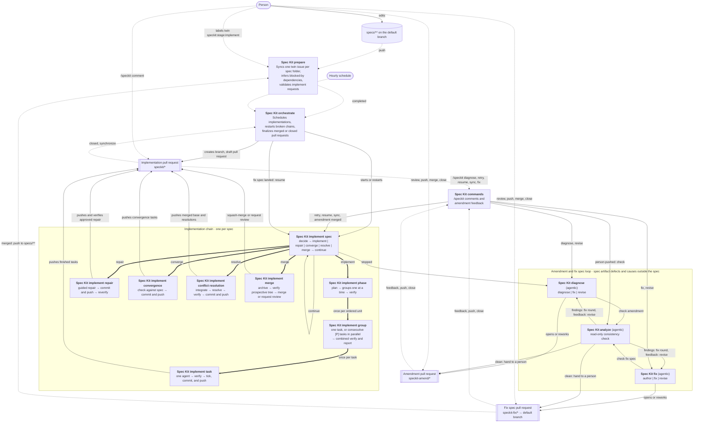

# Spec Kit workflows

The `speckit-*` workflows take a Spec Kit feature folder under `specs/` from a twin issue to a merged implementation.
They run from the default branch and decide from the state on GitHub (issues, labels, pull requests, check runs),
so a run can be repeated or replaced safely.

## Overview



Edges: dotted arrows are GitHub events that trigger a workflow, solid arrows are workflow dispatches or effects on a
pull request, and thick arrows are reusable workflow calls (`workflow_call`) that run inside the caller's run.
Implementation pull requests stay draft while the chain is working, stopped for a decision, or waiting for a diagnosis.
They become ready only after final verification, immediately before an automatic merge or an intentional review handoff.

## Workflows

| Workflow | File | Triggered by | Does |
| --- | --- | --- | --- |
| Spec Kit prepare | [speckit-prepare.yml](speckit-prepare.yml) | Push to `specs/**`, `speckit:stage:implement` label, manual | Keeps one twin issue per spec folder, infers dependencies between new twins, validates implement requests. |
| Spec Kit orchestrate | [speckit-orchestrate.yml](speckit-orchestrate.yml) | Prepare completed, twin closed or reopened, `speckit/*` pull request closed or pushed, hourly, manual | Starts implementation chains up to `SPECKIT_MAX_ACTIVE_SPECS` (default 3; fix specs start regardless), restarts broken chains, finalizes merged implementations, settles amendments and fix specs, and resumes an implementation once its fix spec has landed. |
| Spec Kit implement spec | [speckit-implement-spec.yml](speckit-implement-spec.yml) | Orchestrate, itself, commands | One per run: a phase, a guided repair, the convergence, a conflict resolution, or the merge; then dispatches its next run. |
| Spec Kit implement phase | [speckit-implement-phase.yml](speckit-implement-phase.yml) | Implement spec (`workflow_call`) | Plans one phase's ordered units and calls the group workflow for them serially; verifies the phase after its last unit. |
| Spec Kit implement group | [speckit-implement-group.yml](speckit-implement-group.yml) | Implement phase (`workflow_call`) | Calls the single-task workflow once for a singleton or in parallel for consecutive `[P]` tasks. Multi-task groups always receive full combined verification and reporting; singleton groups add no duplicate work. |
| Spec Kit implement task | [speckit-implement-task.yml](speckit-implement-task.yml) | Implement group (`workflow_call`) | Implements and verifies exactly one task, then validates, ticks, commits, pushes, and reports that task through a write-isolated landing job. |
| Spec Kit implement repair | [speckit-implement-repair.yml](speckit-implement-repair.yml) | Implement spec (`workflow_call`) | Applies writer-approved diagnosis guidance to an already-landed verification failure, lands the repair without changing `tasks.md`, and resolves its durable repair state only after reverification passes. |
| Spec Kit implement convergence | [speckit-implement-converge.yml](speckit-implement-converge.yml) | Implement spec (`workflow_call`) | Runs `/speckit-converge` against the completed implementation with the strong model, validates the tasks-only result, then commits and pushes it. |
| Spec Kit implement conflict resolution | [speckit-implement-resolve.yml](speckit-implement-resolve.yml) | Implement spec (`workflow_call`) | Integrates the base branch, lets Copilot resolve unprotected conflicts when needed, runs final verification, then validates, commits, and pushes the resolution. |
| Spec Kit implement merge | [speckit-implement-merge.yml](speckit-implement-merge.yml) | Implement spec (`workflow_call`) | Archives the spec, builds and verifies the prospective merged tree with a read-only token, then squash-merges the pull request or deliberately hands it to a person for review. |
| Spec Kit commands | [speckit-commands.yml](speckit-commands.yml) | Pull request comments, reviews, and events | Handles `/speckit` commands (`diagnose`, `retry`, `resume`, `sync`, `fix`, `help`) and amendment and fix spec feedback; keeps Spec Kit pull requests out of stacks. |
| Spec Kit diagnose | [speckit-diagnose.md](speckit-diagnose.md) ([lock](speckit-diagnose.lock.yml)) | Implement spec, commands, analyze | Explains why an implementation stopped and recommends one ready-to-post command that fits the category; for spec artifact defects opens and reworks an amendment pull request. |
| Spec Kit fix | [speckit-fix.md](speckit-fix.md) ([lock](speckit-fix.lock.yml)) | Commands (`/speckit fix`), analyze | Authors a fix spec for a cause outside the stopped spec and proposes it against the default branch; reworks it after findings or feedback. |
| Spec Kit analyze | [speckit-analyze.md](speckit-analyze.md) ([lock](speckit-analyze.lock.yml)) | Diagnose, fix, commands | Runs a read-only `/speckit-analyze` of the amended spec folder or the new fix spec and decides between a correction round, a rework, or human review. |

The six implementation work entry points use typed command scripts (`speckit-task.mjs`, `speckit-group.mjs`,
`speckit-repair.mjs`, `speckit-converge.mjs`, `speckit-resolve.mjs`, and `speckit-merge.mjs`). Attempt accounting,
result artifacts, verdicts, and landing stay shared
in `speckit-implement-work.mjs`. Common Actions
script plumbing—GitHub client construction, step summaries, and outputs—lives in `speckit-script-runtime.mjs`.
Git runners, optional-file readers, and link contexts remain local because their buffer, error, or missing-value
contracts differ.

## Units of work

- **Spec:** one feature folder under `specs/`, one twin issue, one `speckit/<folder>` branch, and one implementation
  pull request.
- **Phase:** a `##` heading of the spec's `tasks.md`.
- **Group:** one ordered phase unit: either one task or consecutive `[P]` tasks under one heading.
- **Task:** one checkbox line of `tasks.md`. Groups run serially; the tasks of a multi-task group run in parallel.

Each run of Spec Kit implement spec does one of these: a phase, a guided repair, the convergence
(`/speckit-converge`), a conflict resolution, or the merge. A failed verification of already-landed code records
durable repair state without unticking tasks. Diagnosis recommends `/speckit retry <guidance>`; after a writer approves
it, repair work lands through a write-isolated job and the failed scope must pass reverification before normal planning
continues. For pending repairs, both `/speckit retry` and `/speckit resume` without guidance reverify without a repair
agent; retry keeps the branch as it is, while resume merges the base branch first. With guidance, both run the repair
agent, and a successful no-change result reaches reverification without creating an empty commit. Agent failures and
invalid or out-of-scope patches remain failures. Repair attempts retain their existing limit.
Reverification uses the original failure artifact's changed files together with repair changes, not just the diff since
the failed head. Missing or empty original scope falls back to full (`finalize`) verification. Downloaded evidence is
readable by the repair agent inside its workspace at the locally ignored `.speckit-repair-evidence/`; unavailable
artifacts do not weaken verification. The verification action must actually succeed, and the verified commit must still
be the pull request head, before the marker can resolve; verification-only work uses the decision's pinned head.
Writer-supplied text after `/speckit diagnose`, `retry`, `resume`, `sync`, or `fix` is consistently called
**guidance**. Retry and resume guidance is stored in a bot-authored pull request marker so a replaced dispatch or
hourly continuation cannot lose it. Copilot-bound guidance is whitespace-normalized, capped at 4,000 characters, and
added to every task in the first retried group, or to the first convergence, repair, or conflict-resolution prompt.
Later units do not inherit it. Each restart comment also records the implementation branch head and the base branch
head. While the implementation is stopped (`help wanted`), `Spec Kit commands` refuses a `retry` or `resume` after
`MAX_UNCHANGED_RESTARTS` (2) restarts in a row on the same implementation branch head, because it would most likely
stop the same way again; a resume still runs when the base branch has new commits, and `--force` as the first word of
the guidance insists. The refusal points to a push, `/speckit diagnose`, or `/speckit fix`. A clean merge and a verification-only repair restart invoke no agent, so they consume
no prompt guidance. The chain keeps its branch current with the base branch by pulling: every run starts with
the job `sync` ("Merge the base branch"), which merges the base branch into the implementation branch through the
GitHub API when it is ahead and the next work is a phase that has not started (none of its tasks is ticked yet), the
convergence, the merge, or a resume (`/speckit resume`, a merged amendment, or a landed fix spec; repository variable
`SPECKIT_SYNC_BASE`, default `true`). Retries (`/speckit retry`) and continuations of a started phase keep its base. On a conflict the
decide job of the same run starts the conflict resolution the merge uses (Copilot CLI edits the conflicted files and,
to fix clashes without a textual conflict such as two migrations with the same number, the implementation branch's
own files and new files, never other files of the base branch or protected paths; the full verification runs), and
the next run does the work on the merged branch. A resumed pending repair follows the same sync and conflict-resolution
path before reverification; resolution attempts do not consume its restart authorization or repair guidance.
Before a phase, the convergence, or a resumed repair,
this is best effort: when GitHub refuses the merge, the conflicts touch protected paths, or the resolution fails
`MAX_SYNC_RESOLVE_ATTEMPTS` times, the implementation continues on its current base without stopping, that base commit
is not tried again, and the merge at the end integrates it. Before the merge it is required, as the merge's own
conflict resolution. Nothing reacts to pushes to the base branch: a stopped implementation picks up a fix that landed
there when a person resumes it. The workflow token may push these merges
even when the base branch changed workflow files, because they only bring in commits the repository already has. Job
names say what a job does, without step numbers; GitHub shows their order. The convergence starts with the `gha` extension's `before_converge` hook
`/speckit-gha-drift`, which checks `docs/architecture/` against the implementation; each stale, missing, or
contradicting statement becomes a convergence task, so the architecture is corrected before the merge. The hook comes
from the implementation branch, so a branch created before it existed gets it with the next merge of the base branch.

### Required synchronization

`/speckit sync [guidance]` explicitly requires synchronization before the implementation continues. It uses the
implementation pull request's actual base branch, not an assumed `main`, and is independent of `SPECKIT_SYNC_BASE`
and earlier best-effort skip markers. The request is durable across replacement dispatches and subsequent chain runs.
It is not an alias for `resume`: API refusals, protected conflicts, exhausted resolution attempts, and verification
failures stop for attention instead of continuing on an old base.

The existing conflict-resolution workflow verifies the synchronized tree, invokes Copilot only when needed, and
retains its file restrictions and read-only agent/separate write-capable landing jobs. Clean merges and an
already-current branch also require verification. Before releasing the barrier, the controller checks the current
base again; if it moved, synchronization remains pending. Checked tasks and pending repair evidence are retained;
the original failed scope must still pass, and synchronization does not erase repair attempt limits.
Successful full verification can resolve a pending repair, including one whose repair attempts are exhausted,
when the original failed scope is covered; historical failures remain recorded. Full `finalize` verification
also covers task/group/phase repairs whose original artifact expired. Merged environment-action repairs still
require explicit scope evidence and their self-tests, which ordinary `finalize` verification does not run.

Use `retry` for unchanged work, `resume` for the existing best-effort merge-and-restart behavior, and `sync` when
receiving base-branch changes is a prerequisite. Diagnosis categorizes a fix already on the base as `outside` and
recommends `sync`; inconsistent category/command reports are rejected at publication, not rewritten into retries.

Architecture impact: none. This changes repository automation, not the product design in `docs/architecture/`.

The merge workflow first archives the spec to `specs/archive/<folder>` on the implementation branch (job `archive`),
so the archive lands with the implementation. The controller runs only one of its `phase`, `repair`, `converge`,
`resolve`, or `merge` reusable jobs, so the others
always show as skipped. Prepare, orchestrate, and implement spec also have a `refuse` job that only runs, and fails, when
started from a branch other than the default branch.

## Pull requests that need attention

Implementation, amendment, and fix spec pull requests carry GitHub's default label `help wanted` ("Extra attention is
needed") while they wait for a person, and lose it as soon as a person's action puts automation back to work or the
pull request is merged or closed. The label is a convenience; the comments and check runs stay authoritative.

| Pull request | Labeled when | Unlabeled when |
| --- | --- | --- |
| Implementation | It stopped and no diagnosis runs for it (attempt limit, attention, a diagnosis that could not start or did not finish), a diagnosis reported without an amendment, an amendment or fix spec was discarded or misdirected, a fix spec could not be authored or was not implemented, or it is held for review. | A diagnosis, a `/speckit fix` authoring, a resume, a retry, or a person's push gets it going again, an amendment was merged, or it was merged or closed. |
| Amendment or fix spec | It is presented for review, or a check or rework could not start or did not finish. | A rework starts after feedback, a check starts after a push, or it was merged, closed, or superseded. |

The workflow run titles of Spec Kit diagnose, analyze, and fix follow Spec Kit implement spec: `Spec Kit <workflow>
spec #<twin> · <why the run started>`, for example `Spec Kit fix spec #66 · Write a fix spec that unblocks the
implementation`.

## Copilot CLI and model levels

Every Copilot CLI run of these workflows goes through the composite action
[speckit-copilot](../actions/speckit-copilot/action.yml), loaded from the trusted default-branch checkout, so an agent
cannot change its own model, flags, or deny lists. The agentic workflows (diagnose, analyze, fix) use gh-aw's own engine
settings instead.

Callers choose a strength level, not a model. The levels and their models live in
[models.json](../actions/speckit-copilot/models.json) next to the action, the only place to change models; a new level
is one more entry there:

```json
{ "levels": { "light": { "model": "claude-haiku-5.5", "effort": "medium" } } }
```

| Level | Model | Reasoning effort | Used by |
| --- | --- | --- | --- |
| `light` | `claude-haiku-5.5` | `medium` | Prepare: dependency inference |
| `standard` | `claude-sonnet-5.5` | `high` | Implement task: tasks and conflict resolution |
| `strong` | `claude-opus-5.5` | `high` | Implement task: convergence |

- The action's `model` and `effort` inputs override the level for a rare exception.
- An empty value or `auto` lets Copilot CLI pick its default model.
- When the CLI rejects the chosen model or effort before the agent starts, the action logs a warning and retries once
  with the default model; its outputs `model` and `fell-back` show what ran.
- Mode `inference` gives the model no tools. Mode `agent` allows all tools except `git push`, `git commit`, `gh`,
  `curl`, `wget`, and the caller's `deny-tools`.
- The action pins the Copilot CLI version (`cli-version`).
- Stronger models use the AI-credit budget (`SPECKIT_TASK_AI_CREDITS`, default 1000 per run) faster; raise it when a
  level moves to a stronger model.

The logic (level resolution, arguments, rejection detection) lives in
[speckit-copilot.mjs](../scripts/speckit-copilot.mjs) and is covered by its tests, including a check that
`models.json` is valid and that every `level` used in a workflow exists in it.

## Dependency Download Caches

[Dependency download caches](dependency-cache.yml) populates NuGet and npm downloads from a credential-free checkout
of the default branch. It runs on dependency/tooling changes there, or manually on that branch. Non-default-branch
runs are skipped; it has no input for another checkout ref. It never invokes an agent, builds, or tests. npm
population disables lifecycle scripts; NuGet restore evaluates only the trusted default branch's projects.

The shared [environment setup action](../actions/environment-setup/action.yml) uses explicit **restore-only** cache
actions before installing tools. Implementation and verification jobs never save their modified caches. Restoring
does not execute workspace restore targets or npm scripts. Existing tool installs, `dotnet restore`, `npm ci`,
builds, and tests still run normally. Missing or unavailable caches fall back to ordinary downloads; a hit is not
evidence of a successful build or test.

Keys separate ecosystem, runner OS/architecture, actual SDK or Node/npm versions, and dependency contents. NuGet
inputs include both solutions' central package lists, project files, props, targets, solutions, SDK pins, package
lockfiles when present, tool manifests, and feed configuration. npm inputs include package declarations, lockfiles,
and npm configuration. Tool versions come from the trusted setup and Copilot actions. Keys contain neither a
commit SHA nor an absolute checkout path. There are no broad fallback keys. Bump the `socalytics-downloads-v1`
schema in [cache-keys.mjs](../actions/environment-setup/cache-keys.mjs) when changing cache provenance or format.

Only `~/.nuget/packages` and npm's `~/.npm/_cacache` are saved: no credentials/configuration, npm logs,
`node_modules`, build outputs, test results, databases, or agent state. Configuration contents influence hashes but
are not stored in the caches. A task that changes dependencies may miss the trusted cache until its changes land;
its normal restore still resolves the new dependencies. Separate tasks with unchanged dependency inputs reuse the
same downloads.

### Measurements And Rollout

Before changing the actions, the logs of
[run 38701098384, job 116309370584](https://github.com/markusheiliger/socalytics/actions/runs/38701098384/job/116309370584)
provided this uncached sample on 2026-10-15:

| Operation | Observed duration |
| --- | --- |
| Environment setup (GitHub step timestamps) | 48 s |
| Markdown tool install | 5.6 s |
| Kiota install | 2.0 s |
| Chromium and system dependency install | 19.4 s |
| Platform restore | 6.6 s |
| Platform build | 22.6 s |
| Sequential platform test commands, including startup | 260.2 s |

This conflict-resolution sample had pre-existing test failures and stopped before Manager/Web checks. It is an
initial baseline, **not** a successful acceptance run, a complete phase measurement, or evidence of cache savings.

Every verification now writes separate command durations and exit codes to its log and job summary. GitHub's step
timings distinguish SDK setup, cache restores, and tool installation. Setup summaries report exact cache hits and
uncompressed restored bytes; the population job also queries GitHub for compressed stored sizes. Population time
is reported separately from consumer time.

After this tooling reaches the default branch:

1. Run **Dependency download caches** there to populate the caches, then run it again to verify exact hits and stored
   sizes. Dependency changes also trigger population automatically.
2. Compare successful cold and warm implementation/verification runs with equivalent dependency inputs, runner
   images, verification modes, and test scope. Record setup, restore, build, and test durations separately.
3. Measure the phase's elapsed wall-clock time from planning through phase verification, including scheduling and
   commit jobs; do not add parallel task durations together. Separate Copilot execution from cache-related gains.
4. Track exact hit rates and the sizes/evictions under the repository's Actions cache settings. Cache archives and
   restore overhead can outweigh short restores; retain this scope only when repeated runs show net benefit.
5. To benchmark Chromium independently, dispatch the workflow with **benchmark-chromium** enabled. Two fresh
   runners compare download plus system dependencies with cache restore plus fresh system dependencies. Playwright
   tool installation is outside both timed intervals. A separate always-run cleanup job deletes only that run's
   isolated benchmark cache. If cancellation interrupts cleanup, remove its `socalytics-chromium-benchmark-` entry
   from Actions caches manually.

Chromium caching is **not enabled** for implementation jobs. Only adopt it after repeated benchmarks demonstrate
net savings. No speedup or cold/warm phase comparison is claimed before those default-branch runs complete.

## Editing

The agentic workflows are authored in their `.md` file. Recompile them with `gh aw compile` and never hand-edit the
`.lock.yml` files. Run the workflow tooling tests with `node --test .github/scripts/*.test.mjs`.
