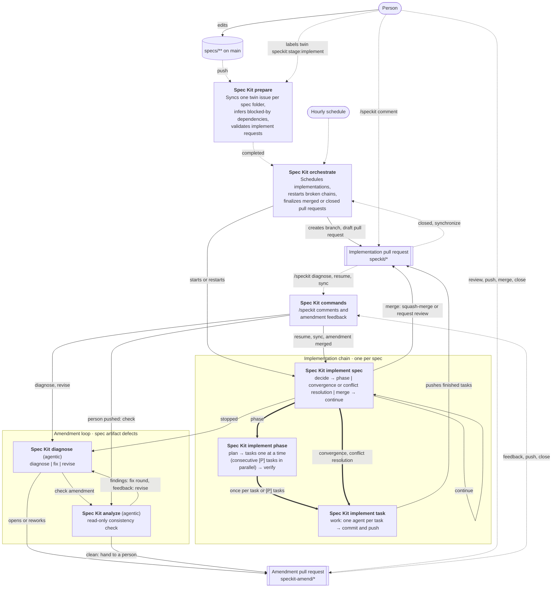

# Spec Kit workflows

The `speckit-*` workflows take a Spec Kit feature folder under `specs/` from a twin issue to a merged implementation.
They run from the default branch and decide from the state on GitHub (issues, labels, pull requests, check runs),
so a run can be repeated or replaced safely.

## Overview

Edges: dotted arrows are GitHub events that trigger a workflow, solid arrows are workflow dispatches or effects on a
pull request, and thick arrows are reusable workflow calls (`workflow_call`) that run inside the caller's run.

## Workflows

| Workflow | File | Triggered by | Does |
| --- | --- | --- | --- |
| Spec Kit prepare | [speckit-prepare.yml](speckit-prepare.yml) | Push to `specs/**`, `speckit:stage:implement` label, manual | Keeps one twin issue per spec folder, infers dependencies between new twins, validates implement requests. |
| Spec Kit orchestrate | [speckit-orchestrate.yml](speckit-orchestrate.yml) | Prepare completed, twin closed or reopened, `speckit/*` pull request closed or pushed, hourly, manual | Starts implementation chains up to `SPECKIT_MAX_ACTIVE_SPECS` (default 3), restarts broken chains, finalizes merged implementations, settles amendments. |
| Spec Kit implement spec | [speckit-implement-spec.yml](speckit-implement-spec.yml) | Orchestrate, itself, commands | One per run: a phase, the convergence, a conflict resolution, or the merge; then dispatches its next run. |
| Spec Kit implement phase | [speckit-implement-phase.yml](speckit-implement-phase.yml) | Implement spec (`workflow_call`) | Plans the order of one phase's open tasks and runs them one at a time, consecutive `[P]` tasks in parallel; verifies the phase after its last task. |
| Spec Kit implement task | [speckit-implement-task.yml](speckit-implement-task.yml) | Implement phase, implement spec (`workflow_call`) | One task, or consecutive `[P]` tasks: a `work` job per task runs the agent and the verification, then a "Commit and push" job commits and pushes them in task order. Parallel edits to the same file are merged and verified together; only conflicting edits are redone. |
| Spec Kit commands | [speckit-commands.yml](speckit-commands.yml) | Pull request comments, reviews, and events | Handles `/speckit` commands and amendment feedback; keeps Spec Kit pull requests out of stacks. |
| Spec Kit diagnose | [speckit-diagnose.md](speckit-diagnose.md) ([lock](speckit-diagnose.lock.yml)) | Implement spec, commands, analyze | Explains why an implementation stopped; for spec artifact defects opens and reworks an amendment pull request. |
| Spec Kit analyze | [speckit-analyze.md](speckit-analyze.md) ([lock](speckit-analyze.lock.yml)) | Diagnose, commands | Runs a read-only `/speckit-analyze` of the amended spec folder and decides between a correction round, a rework, or human review. |

## Units of work

- **Spec:** one feature folder under `specs/`, one twin issue, one `speckit/<folder>` branch, and one implementation
  pull request.
- **Phase:** a `##` heading of the spec's `tasks.md`.
- **Task:** a checkbox line of `tasks.md`. The tasks of a phase run one after another in task order; consecutive
  `[P]` tasks under one heading run in parallel.

Each run of Spec Kit implement spec does one of these: a phase, the convergence (`/speckit-converge`), a conflict
resolution, or the merge. It runs only one of its `phase`, `converge-or-resolve`, or `merge-*` jobs, so the others
always show as skipped. Prepare, orchestrate, and implement spec also have a `refuse` job that only runs, and fails, when
started from a branch other than the default branch.

## Editing

The agentic workflows are authored in their `.md` file. Recompile them with `gh aw compile` and never hand-edit the
`.lock.yml` files. Run the workflow tooling tests with `node --test .github/scripts/*.test.mjs`.
