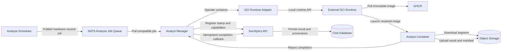
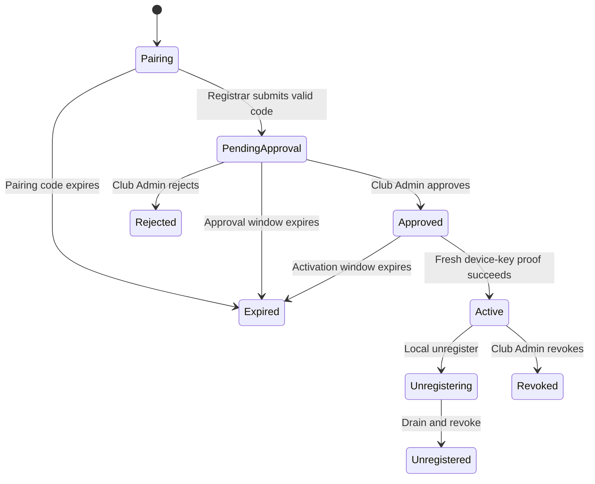

# Analyst Execution Architecture (Provisional)

## Analyst Manager

The Analyst Manager is cross-platform operator software installed on hardware
that participates in a SocAlytics deployment stamp. It is distinct from the
Web UI. Its role resembles the participation model
of the SETI project: an installed client contributes available compute capacity
to a distributed workload. Here, that capacity analyzes match recording video
segments rather than searching radio data for extraterrestrial signals.

Each Analyst Manager connects and registers with exactly one deployment stamp,
advertises its available hardware and runtime capabilities, and consumes
compatible jobs only from that stamp's NATS JetStream work
queue. The platform never addresses an Analyst Manager directly to assign work.

Analyst Managers pull work and ask a built-in OCI Runtime Adapter assembly to
launch the appropriate Analyst container through the configured external
runtime. Runtime-specific assemblies implement one transport-neutral interface
and are selected through configuration and dependency injection. Arbitrary
third-party plugin loading is unsupported.

They match ready jobs to validated host hardware and the pinned Analyst
profile's runtime requirements using control-plane metadata cached by immutable
image digest. They do not substitute an image or model, classify Analyst tiers,
evaluate workflow dependencies, decide when high-level work is ready, or
perform model preprocessing. The Analysis Scheduler and durable Job Registry
own readiness; the pinned Analyst Container owns preprocessing, including
spatial tiling and source-coordinate merging where implemented.

For runtime operations and attempt fencing, see
[Analyst Runtime and Recovery](analyst-runtime-and-recovery.md).

---

## Application Profiles

The Analyst Manager has one implementation with two supported profiles. Both
run in the context of one user account without a system-wide service, the
Manager itself never needs administrator rights, and both share the same Core
worker: a .NET 10
Generic Host without UI dependencies that owns runtime coordination,
credentials, queue consumption, hardware inspection, and the OCI adapters in
C#.

| Profile | Platforms | Process | Controls |
| --- | --- | --- | --- |
| Tray | Windows, macOS, and Linux desktops | Core worker and Avalonia tray application in one process, started at sign-in when the user opts in | Tray menu and status window; the local-control CLI |
| Headless server | Linux | Core worker without Avalonia as a systemd user service, with lingering enabled so it runs without an open session | The local-control CLI only |

### Tray Profile

The tray profile supports opt-in per-user autostart and launches minimized to
the system tray where the desktop provides one. Coordination and active
Analysts continue without an open window. The tray provides actions to open
status, pause or resume dequeue, and exit safely.

The status window shows:

- registered stamp, club, connectivity, operating state, and
  uptime
- active Analyst count and the configured maximum concurrency
- host CPU and memory utilization and available accelerator utilization where
  the runtime can report it
- each active job attempt and the time of its last successful heartbeat
- the approximate stamp-local queue depth for this Manager's
  capabilities, together with the observation time

Queue depth is operational guidance, not a transactional guarantee. The AM
obtains it through the registered stamp API and does not infer permission to
pull work from the displayed value.

Avalonia supplies the tray and status UI in the same process as the Core
worker, without embedding a browser runtime alongside Analyst workloads. The
tray menu offers status, pause, pause for a chosen time with automatic resume,
resume, safe exit, register, unregister, and start at sign-in; where the
desktop has no tray host (for example Linux without StatusNotifierItem
support), a status window offers the same controls. Autostart is opt-in and per
user: the Windows `Run` key of the current user, `SMAppService` (or a per-user
launch agent) on macOS, and an XDG autostart entry on Linux.

### Headless Server Profile

GPU servers without a desktop run the Core worker as a systemd user service.
The enabled user unit replaces desktop autostart. Registration, pause, timed
pause, resume, safe exit, unregister, and status use the local-control CLI;
`register` asks for the host label and shows the pairing code and device
fingerprint for the Registrar. Windows and macOS have no headless profile.

This profile deliberately departs, for Linux servers only, from the earlier
rule that the Manager runs as a desktop application in the signed-in user's
context without an operating-system service (FR-037 of the archived
[Analyst Manager Registration](../../specs/archive/20261005-130704-analyst-manager-registration/spec.md)
spec). GPU servers usually have no desktop and nobody signed in, so the Manager
runs as a lingering systemd user unit instead. What the rule protected still
holds: no system-wide unit, no administrator rights for the Manager, and a
device key, signed state, and local socket that belong to one account.

- **Distributions:** Ubuntu Server 22.04 and 24.04 LTS first; one
  RHEL-compatible distribution (for example Rocky Linux or AlmaLinux 9) later.
- **Preparation:** a one-time administrator step documented in the install
  guide enables lingering (`loginctl enable-linger`), so the service runs
  without a login session. The Manager checks lingering at start and warns
  clearly when it is off. The Manager itself needs neither root nor a
  system-wide service.
- **Account:** with a rootless Podman or Docker runtime, any account may run
  the Manager. With a rootful Docker daemon reached through the `docker` group,
  that account is root-equivalent on the host, so the Manager must run under a
  dedicated non-login service account.
- **Device key:** the same PKCS#11 provider with a tpm2-pkcs11 token as the
  Linux tray profile, backed by a TPM 2.0 or a virtual TPM. For servers without
  one, a stamp may explicitly allow software-backed keys for Managers that
  claim this profile (see
  [Browser Pairing And Approval](#browser-pairing-and-approval)).

### Local Control

One owner-only local socket per user provides single-instance hand-off and the
scripting CLI in both profiles. The Manager verifies that every peer belongs to
the same user and never listens on the network.

### Technology And Delivery

The 2026-10 spike confirmed the Avalonia tray, headless UI tests, and the local
socket. Avalonia remains the Analyst Manager UI technology: the Manager needs
the OCI runtime API, hardware inspection, operating-system keystores,
background execution, autostart, and the local socket, which a browser-based
client cannot provide, and it shares no workflows with the Web UI. Only a
failed required platform capability would reopen the choice.

Installers and updates are open promotion items. Velopack is the preferred
candidate, to be proven by a spike: it installs per user without administrator
rights, signs Windows and macOS installers and notarizes macOS builds, builds a
Linux AppImage, and delivers delta updates. Both Linux profiles use the
AppImage. Because servers often lack the libfuse2 library or `/dev/fuse`, the
AppImage is mounted through FUSE when it is available and otherwise started in
extract-and-run mode, with its temporary directory in a folder owned by the
account running the Manager (for example `~/.cache/socalytics`), never `/tmp`.

The spike runs unsigned first: per-user install, delta update, forward-fix,
uninstall, both Linux start modes on minimal Ubuntu Server images, self-update
in extract-and-run mode, and the stamp-served update feed. The publisher
identity and the Windows and macOS signing services are decided after it, and a
second spike round then proves signing, macOS notarization, SmartScreen, and
Gatekeeper. Should the spike fail, the fallback is decided then. No installer
or update installs or changes the OCI runtime. Runtime footprint while Analysts
execute, accessibility, and long-term maintenance remain open promotion items
as well.

### Updates

Managers fetch updates only from their own stamp. The stamp serves the update
feed as a proxy for the Manager's GitHub Releases and offers only the releases
it allows:

- The release workflow publishes an SBOM and a GitHub artifact attestation
  (build provenance) for every release. The stamp verifies the attestation
  before it offers the release.
- The stamp operator chooses the `stable` or `preview` channel for the stamp.
  The stamp offers the latest release of that channel by default, and the
  operator may pin a version.
- The stamp declares a minimum Manager version. An older Manager admits no new
  work and shows an update notice until it is updated.
- The Manager verifies package hashes, and signatures once releases are
  signed, rather than trusting the proxy.

By default, the Manager downloads an update in the background, drains its
active Analysts, and applies the update; it never updates while Analysts run. A
host-local setting switches to manual updates through the tray or the CLI; the
minimum version still applies. The stamp needs outbound access to GitHub for
the feed.

---

## Registration And Stamp Binding

An unregistered Analyst Manager cannot discover, dequeue, or execute jobs.
First-run registration targets one SocAlytics deployment stamp and requires two
explicit authorization actions:

- a user with the club-level `Registrar` role initiates the registration
- a user with the `Club Admin` role approves or rejects it

Club Admin inherits the Registrar capability. An administrator who initiates a
request may approve that same request, but initiation and approval remain
separate authorized operations and separate immutable audit events.

### Browser Pairing And Approval

Before pairing, the AM generates an asymmetric device key in a supported
operating-system-protected keystore. Activation is refused when no supported
protected store is available; an exportable key-file fallback is not supported.
Hardware-backed storage may be used but is not required.

Supported keystores are per-user and non-exportable: on Windows a CNG key in
the Microsoft Platform Crypto Provider (TPM) when available, otherwise in the
software key storage provider; on macOS a Secure Enclave key when available,
otherwise a Keychain key, reached through a small native bridge because .NET
has no Secure Enclave API; on Linux a key in a PKCS#11 token, with tpm2-pkcs11
as the production module, generated without the extractable attribute because
non-exportability comes from the TPM. The AM reports the kind of protection at
registration; the platform records and shows it as claimed by the AM and never
bases authorization on it, and it refuses software-backed keys unless the stamp
explicitly allows them (by default only for development and test). Outside
development and test, a stamp may allow software-backed keys only for Managers
that claim the headless server profile, for Linux servers without a TPM or
virtual TPM; tray Managers keep requiring hardware-backed keys. The platform can
verify neither the profile nor the protection, so the approval view shows both
as claimed, with a warning (the first Web UI decision view shows the profile
only once Managers report it; see
[Fleet Visibility In The Web UI](#fleet-visibility-in-the-web-ui)). Hardware key attestation is a later decision.
Production approval of any store remains governed by `GOV-CRED-002` in
[Security and Data Governance](security-and-data-governance.md#credential-class-entries).

The untrusted AM requests a short-lived, single-use pairing code bound to its
public key, target stamp, nonce, expiry, and reported device metadata. The
metadata includes a host label that the host operator enters at pairing; the
Manager never sends the machine's host name, which often contains a person's
name. It shows
the platform verification URL, the pairing code, and a short device fingerprint
derived from its public key, and may also show a QR code. The user completes
normal local or external OpenID Connect authentication in the system browser;
human credentials and tokens never pass through the AM.

The authenticated user selects the target club, submits the pairing code
together with the device fingerprint read from the AM, and confirms the host
label. The platform verifies
the Registrar capability and the fingerprint against the paired key, and
creates a key-bound pending request; a wrong fingerprint is refused like an
invalid code, which defeats phished pairing codes (RFC 8628, section 5.4). The
Club Admin decision view shows the fingerprint, the time and network origin of
the pairing request, and a warning to approve only Managers the approver can
physically identify. The human-facing code expires after approximately ten minutes. Once
consumed, the pending request remains available for Club Admin action for 24
hours. Codes and polling handles are high-entropy, rate-limited, narrowly
scoped, and do not reveal request existence through distinguishable failures.

Approval moves the request to `Approved`; it does not issue operational access.
The waiting AM must sign a fresh platform challenge with the paired private key.
Only successful proof activates the registration, assigns its stable Manager
identity, and permits machine-token issuance. Rejected or expired requests
cannot be activated, and retrying creates a new request and audit trail.

### Machine Authentication

Pairing, token issuance, and API calls use authenticated TLS; cleartext
transport is unsupported.

An active AM uses OAuth 2.0 client credentials with `private_key_jwt` client
authentication to obtain short-lived, DPoP-bound API access tokens. Token
issuance validates the registered key, assertion audience, expiry, and unique
identifier. Each API call validates the DPoP proof, request binding, replay
identifier, token audience and scopes, stamp binding, and authoritative active
registration state. AM tokens cannot authorize human or administrative APIs.

The DPoP proof key is the registered device key, so every token request and
API call proves possession of the non-exportable key. Access tokens are opaque
references stored only as hashes and validated against the authoritative
registration on every call, so revocation takes effect without a platform
token-signing key. The AM treats its registration as inactive only after a
refusal that follows its own valid key proof; transport failures never clear
its protected registration.

The registration identity remains valid across restart and routine credential
rotation until local unregister or administrator revocation. The private key
never leaves the protected keystore. Routine rotation preserves the Manager
identity only after proving possession of both the registered old key and the
replacement key. A lost key cannot be recovered, escrowed, or rebound by an
administrator; the old registration is revoked and the host registers anew.

The AM stores its Manager identity, endpoint, stamp binding, key reference,
and last operating intent in a local file readable only by the user's account
and signed with the device key, and restores them across restart and
autostart; any change, or a copy to another account or machine, fails
verification and the AM fails closed. It obtains short-lived, stamp- and
subject-scoped NATS credentials through the authenticated API rather than
storing a durable broker secret.

Every capability advertisement, queue query, dequeue, heartbeat, object-storage
grant, and completion callback is validated against the registered stamp.
Neither local configuration nor a job payload can override the binding.

Rebinding never edits an existing registration in place. It requires
unregistering or revoking the old registration and then completing fresh
pairing and approval against the new stamp.

A local user can unregister from the tray application or the local-control
CLI. The AM pauses dequeue,
drains active Analysts, asks the platform to revoke the registration, removes
stamp credentials and cached stamp data, and returns to `Unregistered`. A club
administrator can revoke an AM from the stamp at any time. Administrative
revocation is an immediate security action rather than a drain: the platform
blocks API authorization and credential renewal, revokes current broker access,
fences active attempts, rejects later heartbeats and callbacks, and instructs
the AM to stop and clean up its containers. Enforcement does not depend on the
AM receiving that instruction. Once the AM observes revocation, it clears stamp
credentials and cached stamp data and enters `Revoked`. After local stamp state
is cleared, it returns to `Unregistered` and can begin fresh registration.

The AM observes revocation through periodic registration-status checks and
through authorization failures from any platform operation, including queue
status, heartbeat, and completion calls. Revocation does not depend on a
runtime-engine notification.

Registration records and security audit events identify the Manager, stamp,
public-key thumbprint, state, initiating user, approving or rejecting
administrator, timestamps, expiry, device metadata, reason, and correlation
identifier. Tokens, assertions, DPoP proofs, private keys, pairing secrets, and
broker credentials are never written to application or audit logs.

Credential destruction, cached stamp-data purge, audit-event minimization, and
retention follow
[Security and Data Governance](security-and-data-governance.md). These
requirements do not weaken immediate server-side revocation or attempt fencing.

The registration lifecycle above is authoritative for machine access. `Active`
means the Manager registration may obtain credentials; it does not mean the
local process is currently accepting work. `Running`, `Paused`,
`RuntimeUnavailable`, and `Draining` are local operating states beneath an
active registration. Changing operating state does not create, activate,
revoke, or rebind a registration.

While `RuntimeUnavailable`, the Manager remains connected only for registration
status, diagnostics, and revocation. It advertises no unavailable capability
and dequeues no work until runtime preflight succeeds again.

```mermaid
stateDiagram-v2
    state "Runtime unavailable" as RuntimeUnavailable
    [*] --> Unregistered
    Unregistered --> RuntimeUnavailable: Register; runtime preflight pending
    RuntimeUnavailable --> Running: Preflight passes; restore running
    RuntimeUnavailable --> Paused: Preflight passes; restore paused
    Running --> RuntimeUnavailable: Runtime or profile becomes unavailable
    Paused --> RuntimeUnavailable: Runtime or profile becomes unavailable
    Running --> Paused: Pause dequeue
    Paused --> Running: Resume dequeue
    Running --> Draining: Local unregister or safe exit
    Paused --> Draining: Local unregister or safe exit
    Draining --> Unregistered: Unregister after active attempts finish
    Draining --> [*]: Safe exit after active attempts finish
    Running --> Revoked: Club administrator revokes registration
    Paused --> Revoked: Club administrator revokes registration
    RuntimeUnavailable --> Revoked: Club administrator revokes registration
    Draining --> Revoked: Club administrator revokes registration
    Revoked --> Unregistered: Clear local stamp state
```

Autostart restores the last Running or Paused state. A deliberately paused AM
does not resume dequeue after reboot. Safe exit is distinct from pause because
an exited process cannot renew leases. When work is active, the tray UI or the
CLI offers cancel or drain-and-exit. A safe exit preserves the stamp registration and the last
operating state for the next start. Forced process or host termination is
handled by lease expiry and retry.

Drain uses a configurable timeout so a hung Analyst cannot block exit or local
unregister indefinitely. When the timeout expires, the Manager follows policy to
cancel the operation or stop and clean up the remaining AM-owned containers.

---

## Fleet Visibility In The Web UI

Club Admins see all of their club's Analyst Managers in the
[Web UI](client-applications.md), not in any one Manager. Registrars see only
the registration requests they submitted. Per Manager, the fleet view lists the
host label, registration state, claimed profile and device-key protection,
connectivity, local operating state (running, paused with its resume time,
runtime unavailable with its reason, draining), active and maximum Analysts,
Manager version, and the time of the last status report.

With its existing periodic registration check, every active Manager sends a
small status report: operating state, the reason when the runtime is
unavailable, active and maximum Analysts, and its version. The platform keeps
only the latest report per Manager and overwrites it with each new one; it
keeps no history, which would otherwise show when a host operator's machine was
running. A Manager counts as offline after a configurable number of missed
reports (for example three), derived from the reporting interval; only explicit
non-production values exist so far.

The view reads only what Managers report to their stamp, through human-facing,
authorized API operations; it never addresses a Manager directly. Its only
actions are approving or rejecting pending requests and revoking registrations.
Host-local actions stay in the Manager, because they act on that machine:
pairing, pause, timed pause, resume, safe exit, unregister, autostart, updates
in manual mode, and the local concurrency limit. Queue depth remains guidance in
the Manager's own status view. The status report is sent with
`POST /api/v1/analyst-managers/self/status` and the fleet is read with the
registration list and detail operations; see
[the platform README](../../src/platform/README.md) and the
[Manager status contracts](../../specs/archive/20261012-153308-manager-fleet-status/contracts/self-status-api.md).

The first Web UI fleet and decision views will not show the claimed
application profile: it follows once the headless server profile exists and
Managers report it, while the claimed device-key protection is shown from the
start. Approving a request will require re-entering the last six characters of
the device fingerprint, and revoking a registration typing the Manager's host
label. The navigation will show Club Admins the number of pending requests.
Club Admins with a verified email address are also notified of pending
requests by email through the
[email channel](email-notifications.md), which is implemented: the first
request sends a message at once and further ones are coalesced within a
window.

---

## Capacity And Pause Controls

The user configures a persisted, host-local maximum number of concurrent
Analysts. It is a positive integer bounded by platform policy and the host's
advertised capability. The effective limit is the lowest applicable bound. The
AM pulls only while its active Analyst count is below that limit.

Increasing the limit allows additional pulls. Decreasing it never terminates an
active Analyst; new pulls remain suppressed until the active count falls below
the new limit.

Pause keeps the AM registered, connected, visible to the platform, and updating
its status. It stops new dequeues immediately while active Analysts continue,
including heartbeats, result uploads, and completion callbacks. A pause may be
set for a chosen time, after which the AM resumes automatically. Resume
restores pulling subject to the effective concurrency limit and capability
matching.

If runtime access is lost, the AM stops dequeue and reports degraded status. It
retries failed heartbeat submissions with bounded backoff while the attempt
lease remains valid, but it cannot assume renewal. The platform may fence and
retry an attempt after lease expiry. On recovery, the AM reconciles existing
containers and their fencing state before it resumes dequeue.

Production-approved effective concurrency, queue and utilization thresholds,
drain timeout, runtime/profile compatibility, degraded-state alerts, and
recovery evidence are profile values governed by
[Production Deployment and Operations](production-operations.md). No default
in this topic implies production approval; unresolved values block readiness
without changing pause, drain, lease, or reconciliation semantics.

---

Related architecture: [Index](README.md) | [Job Processing](job-processing.md) |
[Platform Implementation Profile](platform-implementation.md) |
[Analyst Runtime and Recovery](analyst-runtime-and-recovery.md) |
[Tenancy and Technology](tenancy-and-technology.md) |
[Production Deployment and Operations](production-operations.md)
