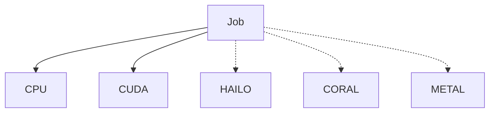

# Analysts, Models, and Hardware

This document defines the executable Analyst package, execution provenance, and
hardware strategy. Container lifecycle behavior is defined in
[Analyst Runtime and Recovery](analyst-runtime-and-recovery.md). The canonical
capability inventory is defined in the
[Analyst Capability Catalog](analyst-capability-catalog.md).

## Analyst Containers

An Analyst Container (AC) is self-contained. SocAlytics defines exactly two
tiers:

- **Low-level ACs** produce foundational match facts. They primarily execute
    against segments, but may execute at match scope when foundational
    continuity crosses segments, such as match identity linkage.
- **High-level ACs** produce soccer concepts and execute at match scope.
    Representative capabilities include possession and transition analysis,
    counter-attack and set-play detection, offensive and defensive formation
    analysis, pressing analysis, and match-level tactical aggregation.

Intermediate soccer concepts remain high-level outputs and may feed later
high-level ACs; there is no third Analyst tier. Tier and execution scope are
independent capability declarations. Example images include:

- `analyst-person-role-detector-rtdetrv2s:cuda`
- `analyst-person-role-detector-rtdetrv2s:hailo8`
- `analyst-person-role-detector-rtdetrv2s:cpu`
- `analyst-ball-detector-rtdetrv2s:cuda`

Contents:

- Model
- Runtime
- Preprocessing
- Tiling
- Postprocessing
- Result writer for the job's result mount
- Versioned `analyst-manifest.json`

### Image Metadata And Packaging

Each Analyst is published to GHCR as an immutable, digest-pinned image. A
versioned `analyst-manifest.json` lives beside its Dockerfile, is copied into
the image, and supplies essential `io.socalytics.*` OCI labels at build time.
The manifest declares capability and dependency versions, runtime and resource
requirements, output schema, video policy, retry and timeout requirements, and
independent image, model, policy, and Analyst-profile versions and digests.

Image publication or registration imports the manifest into a queryable
control-plane metadata cache keyed by immutable image digest. The Scheduler
uses that cache to validate dependencies and resolve an approved Analyst
profile to an immutable image and model pair when it creates an analysis run.
The Analyst Manager advertises host capabilities and admits only jobs whose
pinned image and model it can execute. Changed metadata always produces a new
image digest and manifest version.

The first implementation of a model-based Analyst bundles model weights and all
preprocessing and postprocessing implementation inside the image while
recording an independent model digest (the development images without a model
bundle no weights and declare the no-model digest). This accepts larger images and duplicated weights in exchange for
reproducible execution without runtime artifact downloads or credentials.
External digest-pinned model artifacts remain a future optimization.

The packaging convention for Analyst authors, enforced when an image is
registered by digest (`POST /api/v1/registry/analyst-images`; Club Admins also
register images from the Web UI's Registry administration, see
[Web UI](client-applications.md#web-ui)):

- `analyst-manifest.json` sits beside the Dockerfile and is validated against
  the released manifest schema `contracts/analysis/analyst-manifest/v1/`.
- The last Dockerfile instruction that creates a layer is
  `COPY analyst-manifest.json /opt/socalytics/analyst-manifest.json`, so the
  last layer contains only `opt/socalytics/analyst-manifest.json`. The Registry
  reads only the image manifest, the configuration, and that last layer.
- Build-time labels: `io.socalytics.analyst-manifest.version` (the manifest's
  `manifestVersion`), `io.socalytics.analyst-manifest.sha256` (SHA-256 of the
  file), `io.socalytics.capability.id`, `io.socalytics.capability.version`, and
  `io.socalytics.model.digest`. A missing or differing label refuses the import
  (`labels-mismatch`).
- Supported layer media types are the gzip-compressed and uncompressed tar
  layers of OCI (`application/vnd.oci.image.layer.v1.tar`, `…tar+gzip`) and
  Docker (`application/vnd.docker.image.rootfs.diff.tar`, `…tar.gzip`);
  others are refused (`unsupported-media-type`). Image indexes resolve to
  `linux/amd64`.
- References must use a digest, not a tag, and lie within the configured
  registry host and repository prefix.

A development reference Analyst is implemented as development evidence (see the
[reference Analyst contract](../../specs/archive/20261018-095952-reference-analyst/contracts/reference-media-probe.md)).
The capability `reference-media-probe` is the first Analyst built on the
Analyst SDK: the independent locked Python project
`src/analysts/capabilities/reference-media-probe/`, a low-level,
segment-scoped capability with a `required` video policy and no upstream
dependencies, that decodes its staged segment media with the environment's
pinned FFmpeg build and writes one `frame-second-probe` fact per covered
match-second of the nominal window (decoded-frame count and frame luma
statistics). It contains no model and declares the platform's no-model digest
(`sha-256:` followed by 64 zeros). Its image follows the convention above with
literal labels that the build verifies against the manifest, is built from
the repository root, and uses only pinned inputs: a base image pinned by
digest, the project's `uv.lock`, and the environment's hash-verified uv and
FFmpeg archives; byte-identical rebuilds are not claimed and remain unevidenced.
It runs under any
non-root user on a read-only root file system. It is development evidence
only: it is registered by the Docker-backed end-to-end tests and a documented
local procedure through the normal Registry operations, is never published to
GHCR, and is not part of the
[Analyst Capability Catalog](analyst-capability-catalog.md); only convention
keeps it out of production stamps.

A second development image exists: `media-context-classification` 1.0.0, the
catalog's first named capability, built from the independent locked Python
project `src/analysts/capabilities/media-context-classification/` with its own
`Dockerfile`. It is a shot-boundary baseline only: fixed rules, no model, and
no model weights in the image (it declares the platform's no-model digest). It
follows the same packaging convention and pinned inputs as the reference image
and adds the OpenCV (`opencv-python-headless`) and NumPy wheels, locked in its
`uv.lock`, for frame decoding and comparison next to the environment's pinned
FFmpeg build. A dependency audit under the project's `audit/` folder records
every locked package, the shared libraries bundled in runtime wheels, and the
FFmpeg toolchain with its license, checks each license against an allowed set
(permissive licenses; LGPL only for separately packaged or bundled shared
libraries and the toolchain; no other GPL or AGPL), and is accompanied by a
CycloneDX SBOM that names the base image by digest and does not enumerate
operating-system packages. The project's tests and the image test compare the
audit with the lock and with the distributions installed in the image. This is
development evidence only: the image is never published, no gate of the
catalog is met, and it is not part of any production workflow. Registries and
publication, the catalog's independent license and provenance audit (the
capability's own audit does not replace it), and production values remain open.

### Implementation Profile

Analyst Containers use Python projects managed with `uv`, `pyproject.toml`, and
committed lockfiles. Python is the provisional default because the required
PyTorch, ONNX Runtime, OpenCV, NumPy, SciPy, scikit-learn, SAHI, and accelerator
vendor ecosystems provide the paved path for model and computer-vision work.

Each runtime-specific image may pin a different Python minor version when
native or vendor compatibility requires it. Production builds use locked
dependencies and record package and native-library provenance; they do not
select the newest Python release independently of the validated runtime matrix.

The versioned JSON Schema documents for job inputs and result manifests in
`contracts/analysis/` are canonical; the platform and the Analyst Manager
validate result manifests against them. The shared internal Analyst SDK exposes
Pydantic models and validates both boundaries; cross-runtime schema agreement
is evidenced by the shared contract examples that the platform, the Analyst
Manager, and the SDK's conformance tests all validate. The platform validates
the same schemas independently rather than treating Python types as
cross-language authority.

The Analyst SDK is the
independently locked Python project `src/analysts/sdk/` (distribution
`socalytics-analyst-sdk`, package `socalytics_analyst`), whose major version
follows the contracts' major version. It carries a byte-identical, test-verified
copy of the schemas it implements (analyst-job, analyst-attempt,
result-manifest, upstream-results, fact-artifact, and the common definitions),
validates every document it reads or writes against them in addition to its
typed Pydantic models, and its tests validate every example of those contracts,
so a contract change the SDK does not follow fails its verification. It reads
the job and attempt context, verifies staged upstream manifests against the
input snapshot and staged artifacts against their manifests, writes all facts
of a result into one fact artifact `facts.json`, refuses facts outside the
half-open validity window, derives scope, attempt, provenance, lineage, and
partial-coverage reports from its inputs, and writes artifacts and the manifest
atomically. Its entry point exits 0 only after writing the manifest, 2 for
invalid or unverifiable inputs, and 1 for every other failure. It contains no
capability, model, network client, or credentials.

### Analyst Profiles And Container-Owned Preprocessing

An Analyst profile is a versioned, digest-addressed execution choice for one
capability. It binds an immutable Analyst Container image digest and model
digest to compatible runtime, accelerator, compiler, driver, resource, retry,
lease, stale-timeout, and execution-timeout requirements. Analysis-run creation
resolves one approved profile per capability. Every recording, segment, and
retry for that capability in the match uses the same image and model pair;
changing either artifact creates a new analysis run.

Spatial tiling is detector-specific in-memory processing inside the AC, not a
separate Analyst capability or Segment Service operation. The AC decodes a
source frame once, creates any overlapping tiles in memory, runs inference,
maps detections to source-frame coordinates, and merges overlap duplicates. It
emits only the merged frame-level detections, and tracking runs once on that
merged set. Tiles are not persisted by default or scheduled as logical jobs.
Pixel conversion, model input layout, quantization, normalization, resizing,
padding, tiling, batching, coordinate transforms, and duplicate merging are
opaque implementation details of the digest-pinned container. The Scheduler
and Analyst Manager neither select nor override them.

The hardware-neutral job specifies context appropriate to its declared scope,
for example:

- Team: `team-42`
- Match: `match-17`
- Analyst: `person-role-detection`
- Analyst profile: `person-role-detection-rtdetrv2s-cuda-v1`
- Analyst-profile digest: `sha-256:<profile-digest>`
- OCI image digest: `sha-256:<image-digest>`
- Model digest: `sha-256:<model-digest>`
- Recording-set version: `recording-set-v7`
- Recording version: `recording-v3`
- Timeline-mapping digest: `sha-256:<mapping-digest>`
- Segmentation-policy digest: `sha-256:<policy-digest>`
- Segment number: `34`

A match-scoped job instead identifies the analysis run, match, capability, and
dependency results; it does not invent a synthetic segment.

The Scheduler resolves a mutable profile alias, if one was requested, before
creating the immutable analysis-run snapshot. The Analyst Manager does not
resolve tags or select an alternative image or model. It may claim the job only
when the host satisfies the pinned profile and reports the image and model
digests actually used after execution.

The Analyst writes its result and manifest into the job's result mount, and the
Manager stores them in stamp-local object storage through write grants (see
Result Manifest And Lineage). The Manager then calls the stamp API with team, match, job, and execution
identifiers, the manifest URI and checksum, status, idempotency key, selected
runtime, executed image and model digests, and current lease/fencing token.
Analysts and Analyst Managers never receive database credentials.

### Capability Declaration

The control-plane metadata cache owns the imported, versioned declaration from
each digest-pinned Analyst image. It includes:

- capability ID and version, Analyst tier, and independently declared execution
    scope (`segment` or `match`)
- required upstream capability and schema versions, and per dependency whether
    the capability permits partial upstream coverage and its minimum (implemented
    as development evidence against the simulated Analyst; see
    [Readiness And Dependencies](job-processing.md#readiness-and-dependencies))
- whether source video access is required, optional, or forbidden
- output schema version and compatible Analyst-profile identities
- immutable image and model digests plus runtime and hardware constraints
- resource requirements plus retry, lease, stale-timeout, and execution-timeout
    requirements
- deterministic behavior and idempotency expectations

The Analysis Scheduler uses this declaration to construct workflow nodes and
evaluate readiness, then copies resolved declarations and Analyst-profile
bindings into the immutable run and node snapshots. The Analyst Manager uses
only the ready job's pinned artifacts and requirements to determine whether it
can claim the work; it does not select artifacts, classify the tier, or evaluate
dependencies.

### Result Manifest And Lineage

Every tier emits a versioned result manifest containing:

- team, match, recording-set version, and either complete materialized-segment
    identities and nominal half-open windows or full-match scope
- capability, Analyst profile, model or policy, output schema, workflow, and
    OCI image versions and immutable digests where applicable
- accepted execution-attempt identity and immutable result URI and checksum
- nominal validity window and fact count
- complete upstream lineage: accepted result IDs, capability and schema
    versions, and algorithm-qualified artifact digests
- the input coverage used per upstream dependency, required for
    partial-coverage dependencies and compared with the job's input snapshot on
    acceptance (implemented as development evidence against the simulated
    Analyst)
- output type (`foundational-facts` or `soccer-concepts`), confidence, and
    supporting evidence references
- optional supporting video-segment identifiers that the API can resolve,
    never embedded credentials or durable presigned URLs

The AC writes its immutable result artifacts and the manifest into the job's
result mount; it receives no object-storage write credentials. The AM checks
the manifest against the versioned result-manifest contract and never uploads
a manifest that violates it; it then reports a failed attempt. Otherwise the AM
stores the objects in stamp-local object storage through short-lived write
grants that the API issues per object for the attempt's own result location;
each grant fixes the object's name, size, and digest and never outlives the
attempt's lease. The AM then completes through the API callback. Before
acceptance, the API reads the manifest from storage and validates the current
fenced attempt, the manifest's checksum and schema, team and match scope,
pinned Analyst-profile, image and model digests, declared dependencies,
complete lineage, the reported input coverage against the job's input snapshot,
the stored artifacts' digests, and that every emitted fact
falls within the nominal half-open validity window. A manifest that fails any
check ends the attempt as failed with a named reason, and the normal retry
rules apply. The API then marks the result accepted and indexes queryable facts
in stamp metadata. ACs never write metadata tables directly. The result write
grants, the result-manifest contract, and this validation are implemented as
development evidence against the simulated Analyst and against a real Analyst
container on the Docker Desktop profile, as are fact validation and indexing
(development evidence against the simulated Analyst), and so is
capability-specific payload validation against the pinned payload schemas
(see Fact payload schemas below). Still open: no catalog capability declares
payload schemas in its manifest (the development baseline `media-context-classification`
keeps its payload schema in its project, not in its `1.0.0` manifest), the limit values are development values, and the platform
neither interprets payloads nor computes quality metrics from them.

Fact indexing is implemented as follows. Facts travel in
result artifacts whose manifest media type is
`application/vnd.socalytics.facts+json` and that follow the versioned
`fact-artifact` contract in `contracts/analysis/`: a platform-owned envelope
with the capability, output schema version, and output type, and per fact a
capability-owned kind, a half-open match-time range, a confidence, and a
capability-owned payload object. Before acceptance, the API reads every fact
artifact and checks its envelope, its payloads against the pinned schema of
their kind when the capability declares one (see Fact payload schemas below), its
agreement with the manifest and the run-pinned node snapshot, that every range
lies within the validity window, that the facts add up to the declared fact
count, and configured size limits; a failure ends the attempt as failed with a
named reason. The API stores each fact as an immutable record of the accepted
result in the same transaction as the acceptance, so no partially indexed
result is ever visible.

Fact payload schemas are implemented as development evidence. A capability
declares, per fact kind it emits, a payload schema in the Analyst manifest
(`output.factPayloadSchemas`, manifest contract `1.2.0`; manifests `1.0.0` and
`1.1.0` stay valid without it) written in a
restricted, self-contained subset of JSON Schema 2020-12: no format
assertions, no external references, internal `$defs` and `$ref` only, and
fixed size and depth limits (development values). The Registry validates and
caches the declaration with the image and refuses a violating manifest at
import; profile and workflow bindings pin it
through the image digest, and each run's node snapshot pins the schemas and
their digest (runs created earlier are never validated retroactively). Before the accepting transaction, result acceptance validates
every fact payload against the pinned schema of its kind within a bounded
duration (`Analysis:Results:PayloadValidation:MaxDuration`, a development value), and a capability
that declares any schema must declare every kind it emits. A violation ends the
attempt as failed with a named, bounded reason (`result-payload-invalid`,
`result-payload-kind-undeclared`, or `result-payload-validation-bound`, never
carrying a payload value) and leaves no visible fact;
payloads are never rewritten, and normal retry rules apply. The Python Analyst SDK performs the same check
automatically before it writes a result and always fails the write on a
violation. The `reference-media-probe` development capability has a `1.1.0`
variant that declares a payload schema for its fact kind, built from its own
`Dockerfile.payload-validated`; no catalog capability declares payload schemas
in its manifest yet, and the platform neither interprets payloads nor computes quality metrics
from them.

### Capability-Scoped Result Access

A high-level job receives its team, match, analysis-run, and accepted-
dependency context. Its accepted upstream data is retrieved through one
capability-scoped, schema-versioned API pattern. A query identifies the analysis
run, capability and schema version, match or team scope, optional segment or
time range, and pagination. The response uses a stable envelope with a
capability-owned payload and explicitly reports coverage per expected upstream
segment as accepted, missing, failed, blocked, or skipped. Within one run,
accepted results are never superseded; supersession applies only across runs,
which a job's read never crosses. A superseded run keeps its accepted results
as readable history through reads of that run only.

The AM performs that query on the AC's behalf, because ACs receive no platform
credentials. Before launching a high-level attempt, the AM reads every upstream
dependency of the job for the current, unfenced attempt. It downloads each
accepted result's manifest and artifacts through short-lived per-object read
grants and verifies their digests. It then stages them, with the coverage, into
the attempt's read-only input mount. The AC reads only from that mount. The read
returns exactly the accepted results recorded in the job's input snapshot, so
the staged inputs equal what acceptance checks as lineage. Staged inputs are
bounded by a configured size and deleted when the attempt ends. This
Manager-mediated read, the staging, and the coverage are implemented as
development evidence against the simulated Analyst, whose match-level lineage
is built from the staged inputs; real Analyst execution is implemented on the
Docker Desktop profile, and segment media access for ACs through Manager
staging is implemented, while production evidence remains future work. The member fact read described below is implemented
as development evidence against the simulated Analyst. For a dependency that permits partial coverage,
the read reports the coverage recorded in the job's input snapshot together
with the declared coverage mode, and members see each node's input coverage
counts in the run status read (implemented as development evidence against the
simulated Analyst).

Only accepted results are visible. Every response and reference is constrained
to the job's authorized team and match, and Analysts never query PostgreSQL
directly. If the run-pinned Analyst profile's video policy permits video, the
AC receives its segment's materialized media staged by the AM through
short-lived per-object read grants, as described in
[Analyst Runtime and Recovery](analyst-runtime-and-recovery.md#runtime-preflight-and-status)
; the AC itself never receives presigned access,
and video bytes do not pass through the API.

The same capability-scoped pattern is implemented for people (development
evidence against the simulated Analyst; the Web UI's connected analysis review
is its consumer, see [Web UI](client-applications.md#web-ui)): members with
read access to a run's team (Club Admins, and Coaches and Viewers of the team)
read a run's indexed facts per capability, capability
version, and output schema version through the member-facing `/api/v1`
operation `listAnalysisRunFacts`, optionally narrowed to a match-time range and paginated in stable
time order. Each response states the run's state, the run-pinned provenance
(workflow, Analyst profile, image and model digests), and coverage for every
expected execution unit as a half-open match-time window that is accepted,
missing, failed, blocked, or skipped, without segment, recording, or storage
identifiers. The operation `listAnalysisRunFactStreams` names every capability
node of the run with its fact count and coverage. Both reads carry a weak ETag
and never cross runs.

The Web UI's same-match terminal-run comparison is decided but not yet
implemented (see [Web UI](client-applications.md#web-ui)). It will consume
each selected run's independently authorized stream summaries and pinned
provenance, alongside run-status input coverage and recording lineage, without
downloading fact payloads or introducing a cross-run endpoint. Unique
capability-and-scope alignment is only a presentation aid; contract, input
coverage and provenance differences stay explicit, and neither matching
counts nor metadata establish equal full inputs, equivalent outputs or quality.

The evidence of those facts is resolvable to video by the same members, as
development evidence (see
[Evidence Clip Access](../../specs/archive/20261017-224326-evidence-clip-access/spec.md)):
a member-facing `/api/v1` operation resolves one indexed fact of a run (with
optional, bounded context before and after it) or an explicit, bounded
match-time range of the run to ordered parts. Parts come only from the run's
own finalized recording-set version, timeline mappings, and pinned
segmentation policy; where several recordings cover the same match time, the
first recording in the set's order is used. Each part is either a short-lived,
read-only, per-object presigned link to the covering materialized segment's
media, with its media digest and the start and end offsets inside that media,
or an explicit state: `materializing` or `rematerializing` (the operation has
requested the segment from the Segment Service and returns a retry hint),
`failed` with the sanitized reason, or `not-covered`. Before issuing a link,
the platform confirms the media's attested digest and size and the manifest
checksum; it never reads media bytes, never stores or logs links, re-evaluates
team authorization on every request, rate-limits resolutions per member, and
records each resolution that issues links as an artifact-authorization audit
event without the links. This is the API side of `get_video_clip()`; the MCP
tool remains future work. Production link lifetimes, rate limits, content
delivery, and the production storage origin remain unresolved.

---

## Model Governance

Analyst-profile selection is controlled by the platform at analysis-run
creation. The resolved profile pins the model and OCI image. The Analyst
Manager may execute the work only on a compatible host and cannot substitute a
different runtime-specific image or model.

Every execution records the requested model and exact image provenance, for
example:

- Analyst capability: `person-role-detection`
- Analyst profile: `person-role-detection-rtdetrv2s-cuda-v1`
- Analyst-profile digest: `sha-256:<profile-digest>`
- Model digest: `sha-256:<model-digest>`
- OCI image digest: `sha-256:<image-digest>`

This allows:

- reproducibility
- auditing
- comparisons across seasons

Every named framework, transitive dependency, pretrained weight, and dataset
requires a recorded license and provenance audit. Training code, inference
graph, model weights, preprocessing, thresholds, and policy are independently
traceable through the image, model, and policy artifacts that contain them.
Production jobs resolve immutable Analyst-profile, OCI image, model, and policy
digests; floating profile, image, model, or package names are not valid
production provenance. Promoting a challenger changes only newly created run
snapshots; active and historical runs retain their pinned artifact pair.

Artifact authorization, vulnerability handling, exceptional execution, audit
evidence, retention, and deletion follow
[Security and Data Governance](security-and-data-governance.md).

### Implementation Validation

Implementation must verify stamp isolation, capability matching, lease and retry
behavior, duplicate completion handling, result-manifest validation, and OCI
digest capture. It must also validate the tray profile on Windows, macOS, and
Linux and the headless server profile on Ubuntu Server 22.04 and 24.04 LTS,
including the lingering check, rootless and rootful runtimes, and the account
rule. For the headless profile, automated tests give evidence of the
lingering check, the generated systemd user unit, and the account rule
against the simulated runtime; the boot behavior on both Ubuntu Server
releases is open until a person performs the manual validation after the
merge, and rootless and rootful runtimes stay open until a Linux runtime
adapter ships (the Docker Desktop adapter reaches a Linux engine only in
Development and Test). The Velopack spike proves, unsigned first, per-user install, delta
updates, forward-fix, uninstall that leaves the OCI runtime untouched, the FUSE
and extract-and-run start modes on minimal server images, self-update in both,
and the stamp-served update feed with attestation checks and drain before
applying (the minimum version is already enforced by the platform and the
Manager); a second round after the publisher decision proves
signing, macOS notarization, SmartScreen, and Gatekeeper. Implementation must
also validate
registration bootstrap, protected credential storage, rotation, and revocation; and measure concurrency control, queue-depth
reporting, heartbeat ingestion cost, and suitable interval and timeout values.
Queue depth is observable per Manager through the stamp's queue-depth operation
and the Manager's status view; the measurement itself remains open evidence.

Failure tests must cover pause with active jobs, local unregister after drain,
administrator revocation, process and host failure, network partition, forced
exit, stale re-enqueue, and late callbacks from fenced attempts. The choice is
also requires a Windows runtime spike covering Docker Desktop and Podman profile
APIs, local endpoint authorization, runtime and VM restart, orphan
reconciliation, incompatible upgrades, disk exhaustion, and image pull and
launch latency. Security tests must reject forbidden mounts, devices,
privileges, host namespaces, and runtime endpoint exposure. The Docker Desktop
adapter's tests evidence the Engine API path against a Linux engine, an
SDK-built Analyst (`reference-media-probe`, and the shot-boundary baseline
`media-context-classification`) that decodes Manager-staged segment
media in a restricted container from its digest-pinned image, with its facts
accepted, indexed, and read by members (validation of presigned video access
stays open), the local
endpoint policy (remote and unauthenticated endpoints refused), orphan
reconciliation of the Manager's own labelled containers, and the launch
restrictions (non-root user, read-only root filesystem, no network, dropped
capabilities, no privileged mode, host namespaces, or runtime socket mount,
and no devices). Podman, Windows automation, runtime and VM restart,
incompatible upgrades, disk exhaustion, and pull and launch latency remain
open.

CPU is the mandatory baseline. CUDA must be validated end to end through the
Windows Docker Desktop and WSL2 path. Hailo and Coral require separate proof of
Windows driver support, VM or WSL2 device visibility, safe device mapping,
vendor-runtime compatibility, reconnect behavior, and non-privileged operation.
If either accelerator cannot satisfy those requirements, it remains unsupported
on Windows in the first release; the architecture must not weaken isolation or
silently execute the Analyst natively.

The spike must also review Docker Desktop licensing and support obligations and
compare them with externally managed Podman. The resulting compatibility
matrix and evidence must support the desktop, registration, runtime ownership,
security, accelerator, job, callback, and provenance boundaries above before
additional host profiles are supported.

Development evidence for high-level read authorization exists: the
Manager-mediated upstream read refuses other runs, non-upstream capabilities,
and fenced attempts without disclosure, and the staged inputs equal the lineage
that acceptance checks, proven end to end against the simulated Analyst and
against a real Analyst container on the Docker Desktop profile.
Workflow evidence must additionally validate capability and result-manifest
schema compatibility, complete upstream lineage, and high-level API
authorization against real Analysts and production credentials, and validate
presigned video access, and the performance and cost of match-level high-level
ACs on participating hosts.

---

## Hardware Strategy

### Execution Hardware

Examples:

| Runtime | Purpose |
| ---------- | ---------- |
| CPU | Mandatory Windows baseline |
| CUDA | First Windows accelerated profile to validate |
| Hailo | Requires Windows device-pass-through evidence |
| Coral | Requires Windows device-pass-through evidence |
| Metal | Future macOS execution profile |

---

Related architecture: [Index](README.md) |
[Platform Implementation Profile](platform-implementation.md) |
[Analyst Capability Catalog](analyst-capability-catalog.md) |
[Job Processing](job-processing.md) |
[Analyst Manager](analyst-manager.md) | [Analyst Runtime and Recovery](analyst-runtime-and-recovery.md)
