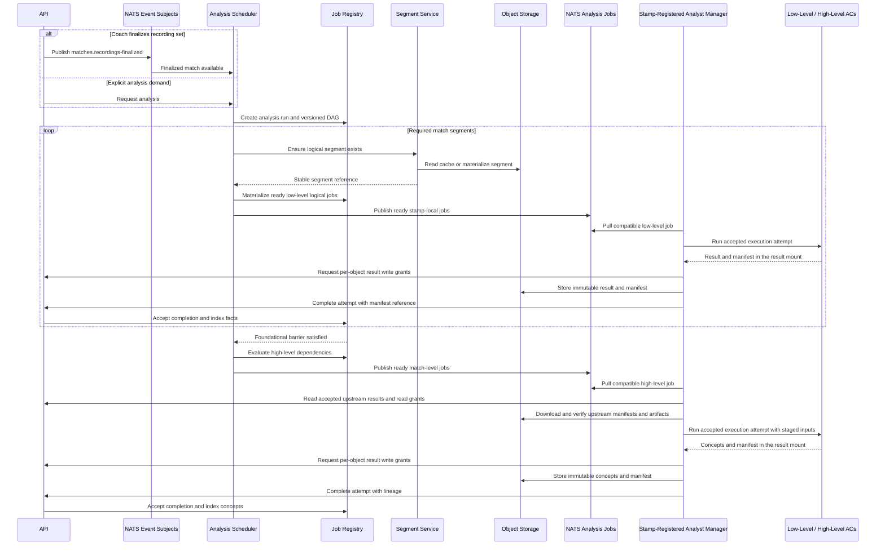

# Event-Driven Job Processing (Provisional)

NATS carries two distinct kinds of traffic:

- event subjects publish lifecycle notifications such as
    `matches.recordings-finalized`
- analysis job subjects use JetStream work-queue and pull-consumer semantics

The control-plane Analysis Scheduler reacts to upload policy or explicit
analysis demand and executes a versioned full-match capability graph. The Job
Registry is the durable system of record for workflow state and dependency
readiness. NATS transports lifecycle notifications and ready jobs only.
Analyst Managers pull work; the platform does not push jobs to a specific host.

## Reliable Event Publication

The control plane writes domain state and outgoing event records to a
PostgreSQL transactional outbox in the same database transaction. A background
publisher delivers pending records to NATS JetStream with bounded retries and
records successful publication. Direct publish-after-commit is not the durable
boundary because a process failure between commit and publish could lose an
event.

Delivery is at least once. Event consumers, job materialization, and completion
handlers therefore use stable identifiers and idempotent processing. Outbox
age, retry count, failure state, and publication lag are observable, and
retention removes only records whose publication outcome is known. Retention,
deletion, audit, replica, and backup obligations then follow
[Security and Data Governance](security-and-data-governance.md).

### JetStream Topology

Each stamp uses two JetStream streams:

| Stream | Subjects | Retention | Content |
| --- | --- | --- | --- |
| `SOCALYTICS_EVENTS` | `matches.>`, `analysis.events.>` | limits | lifecycle notifications such as `matches.recordings-finalized` and `analysis.events.run-state-changed` |
| `SOCALYTICS_ANALYSIS_JOBS` | `analysis.jobs.ready.>` | work queue | ready Logical Jobs on `analysis.jobs.ready.<capability-id>` |

Topology provisioning creates, idempotently on `SOCALYTICS_ANALYSIS_JOBS`, one
durable pull consumer per capability of the default workflow definition
resolved from the Analyst Registry, and only once that definition resolves. The
consumer is named `analyst-<capability-id>`, filters on
`analysis.jobs.ready.<capability-id>`, uses explicit acknowledgement with
`AnalystWork:ConsumerAckWait`, and has unlimited redelivery. A configured
workflow definition does not provision consumers; in Development and Test it
only seeds an empty Registry. Queue-credential assignment gives a Manager the
consumer of an offered capability only when the offered capability id and
semantic version equal the resolved definition's. Production stream and
consumer values remain unresolved.

The publisher sets the outbox message identity as the JetStream message ID, so
the stream's duplicate window suppresses repeated publication of the same
record. When reconciliation republishes a record in a later publication round,
it uses a round-specific message ID so the broker accepts it again; the
payload's own identities do not change. The control plane consumes
`matches.recordings-finalized` through a durable consumer with explicit
acknowledgement. Stream and subject names are configuration with these
defaults; broker credentials, limits, and replica counts per environment
remain production values governed by
[Production Deployment and Operations](production-operations.md).

## Durable Workflow Model

The Scheduler owns graph evaluation and the Job Registry persists four related
levels of state:

- **Analysis run:** team, match, finalized recording-set version, workflow
    definition and version, requested capability set, overall state,
    timestamps, and completion policy.
- **Workflow node:** one capability in the graph, including tier, execution
    scope, required inputs, resolved Analyst-profile, OCI image, model and
    policy digests, retry and timeout policy, and dependency edges.
- **Logical job:** one schedulable segment-level or match-level realization of
    a workflow node. Logical jobs are hardware-neutral.
- **Execution attempt:** one leased execution of a logical job using the claim,
    heartbeat, fencing, retry, and accepted-completion semantics defined in
    [Analyst Runtime and Recovery](analyst-runtime-and-recovery.md).

This hierarchy is `analysis run → workflow node → logical job → execution
attempt`. NATS is not a workflow state store and does not decide dependency
readiness.

### Durable Foundation

The Analysis functional area persists, in the platform's
application schema, Analysis Runs, Workflow Nodes and run-local dependency
edges, Logical Jobs, Execution Attempts, immutable accepted-result references,
idempotency, notification deduplication, and its outgoing events through the
platform outbox. Registry-owned workflow,
capability, Analyst-profile, model, schema, runtime, policy, resource, retry,
and timeout versions are validated through typed Registry application queries;
these queries resolve the stamp's default workflow from the Registry, that is,
approved, content-addressed Analyst profiles and their digest-keyed capability
declarations. A configured workflow definition is used only to seed an empty
Registry in Development and Test.
Analysis stores the resolved capability declaration, Analyst-profile, OCI
image, model, policy, schema, resource, retry, lease, stale-timeout, and
execution-timeout identities and values in immutable run and node snapshots.
Container-owned preprocessing has no independently selectable job identity.

Every time a Logical Job becomes ready, the platform records a **readiness
occurrence**: a stable occurrence identity and a per-job readiness sequence
(1 for the first readiness, incremented for each retry readiness). Exactly one
occurrence is current per ready Logical Job. The ready-job message carries the
occurrence identity, its sequence, and a message identity that stays the same
for every republication of that occurrence. A claim must name the current
occurrence and the message; a claim for a superseded occurrence is
deterministically obsolete, so redelivered or republished messages of an
earlier readiness can never start an attempt.

Integration tests cover hierarchy round trips, immutable run
snapshots, acyclic graph validation, hardware-neutral Logical Jobs, attempt
number and entity-version conflicts, accepted-result lineage and fencing,
duplicate or fabricated notification rejection, and restart recovery
with NATS empty or unavailable. Outbox tests cover atomic state publication
records, broker outage, retry, restart, and expired leases.

For a segment-level logical job, the stable segment reference is an analysis
segment reference from the [Segment Contract](match-data-pipeline.md#segment-contract):
the finalized recording-set-version ID plus the complete materialized identity
of recording-version ID, timeline-mapping digest, segmentation-policy digest,
and segment number. The Scheduler accepts it only after membership and
match/team scope validation. Recording-set-only revisions may reuse the same
materialized media while retaining distinct analysis-run lineage.
Machine-readable job and completion schemas live under
`contracts/analysis/`, introduced by the Durable Analysis Workflow ahead of
Analyst execution; they preserve these identities and fencing boundaries
and evolve additively within their major version.

## Readiness And Dependencies

For each analysis run, the Scheduler:

1. Materializes required logical segments on demand. At run creation the Scheduler requests the materialized
    identity of every segment-scoped job whose run-pinned Analyst profile's
    video policy is `required` or `optional`, never for `forbidden`. Such a job
    stays waiting until its segment is `available`, and its input snapshot and
    job message then pin the segment association (the segment manifest's
    checksum). When the segment ends `failed`, a `required` job fails with
    `segment-unavailable` and the normal dependency and coverage rules apply,
    while an `optional` job becomes ready without media.
2. Creates one logical job per segment for each segment-scoped capability and
    one logical job per match for each match-scoped capability. Every job for a
    capability copies the same run-pinned Analyst-profile, OCI image, and model
    digests.
3. Fans out ready low-level jobs across segments and capabilities. Foundational
    capabilities may depend on other foundational capabilities, such as
    tracking depending on detections.
4. Waits until accepted, API-indexed foundational results exist at the declared
     versions for all required match segments, except through a dependency that
     declares partial coverage, which waits only until every expected segment
     job is final and the accepted segments meet the declared minimum (see
     the partial-coverage paragraph below). Match-consistent continuity work,
     such as track and identity reconciliation, is part of this barrier when a
     downstream capability declares it.
5. Publishes a match-level high-level job only after every declared upstream
     capability, schema, and result version is available. High-level nodes may
     depend on other high-level nodes, for example possession and transition
     analysis before counter-attack classification.
6. Marks downstream nodes blocked when required upstream work fails. Blocked
     logical jobs are never published to NATS.

Each dependency edge is explicitly `required`, `optional`, or `conditional`.
A required failure blocks the dependent job. An optional result is consumed
when accepted but never delays or blocks readiness. A conditional dependency is
required only when its declared predicate applies; otherwise it behaves as an
optional input. For `person-tracking`, accepted media context is consumed when
available, but missing or failed media context does not block tracking from
accepted person detections.

Conditional predicates come from a closed, versioned vocabulary and are
evaluated only from durable run state and accepted results; a predicate that
cannot yet be determined is treated as applicable. Readiness changes for one
run are serialized so that concurrent completions cannot hide each other's
accepted results.

Match-scoped foundational jobs wait for the required segment results declared
by their capability. When a capability permits partial coverage, its input
snapshot records each expected upstream segment as `accepted`, `failed`, or
`blocked`, and the result reports the same coverage explicitly; partial input
is never mistaken for a complete match barrier.

Partial-coverage barriers are implemented as development evidence against the
simulated Analyst. A match-scoped capability declares partial coverage per required or conditional
dependency in its Analyst manifest, with a minimum of at least one accepted
segment and an optional minimum accepted fraction of the expected segments;
segment-scoped capabilities and optional dependencies cannot declare it. The
declaration is copied into the run snapshot. Through such a dependency on a
segment-scoped upstream, a failed or blocked upstream node does not block the
match-scoped job by itself: the job waits until every expected upstream segment
job is final (accepted, failed, or blocked) and becomes ready when the accepted
segments meet the minimum, or blocked by that upstream when they do not. Its
immutable input snapshot records each expected segment's state, the Manager's
upstream read and staged inputs report exactly that coverage, and the result
must report the same coverage to be accepted. Dependencies without the
declaration, and all dependencies between segment-scoped capabilities, keep
complete-coverage barriers and node-level blocking. A run whose failed or
blocked segments were bridged this way still ends `PartiallyCompleted`, never
`Completed`.

Detection, tracking, counter-attack detection, and formation analysis are
capability names, not execution components. New capabilities extend a versioned
graph and capability registry rather than requiring a new workflow service.
The representative dependency graph and complete initial inventory are defined
in the [Analyst Capability Catalog](analyst-capability-catalog.md).

Spatial inference tiles are internal, in-memory detector inputs. They are not
workflow nodes, logical jobs, or NATS messages. The Scheduler operates on the
declared detector capability and receives only its merged source-frame result.

## Run State And Recovery

An analysis run can be `Requested`, `Running`, `PartiallyCompleted`,
`Completed`, `Failed`, or `Cancelled`. A workflow node may additionally be
`Blocked` when a required dependency fails, and `Cancelled` when its run is
cancelled. Node and logical-job state
is sufficient to reconstruct dependency readiness after a Scheduler or control-
plane restart. A match-scoped result built from partial coverage keeps its run
from ending `Completed`: failed or blocked segment nodes bridged through a
partial-coverage dependency still end the run `PartiallyCompleted`.

Retrying an execution attempt does not restart its analysis run. Accepted
upstream outputs are reused, duplicate or stale completions are rejected by the
existing fencing rules, and cancellation immediately stops publication,
revokes queued work, advances or invalidates attempt fencing tokens, and
rejects later completions. Stopping an active container is best effort;
correctness relies on completion rejection.

Member-initiated cancellation is implemented as follows. Club Admins and
Coaches of the owning team cancel a `Requested` or `Running` run through the member API, naming the run's version; the run records who
cancelled it, when (its end time), and an optional plain-text reason, and the
transition is audited and announced through the run-state-changed
notification without the reason. In the same transaction the run's unfinished
workflow nodes and logical jobs become `Cancelled`, its active attempts are
closed as `Cancelled` without consuming attempt budget or being republished,
and its pending ready-work publications are discarded. Work messages already
queued become obsolete: their claims are refused because the job is no longer
ready, and later heartbeats, result-grant requests, upstream reads, and
completions of the closed attempts are refused as obsolete. Results the run
accepted before the cancellation remain immutable, readable history. A
cancelled run never transitions again, cancelling another terminal run is
refused, and repeating a cancellation is idempotent.

Automatic supersession of older runs is implemented as follows (migration
`0027_analysis_run_supersession.sql`). When the run of a newer finalized
recording-set version of a
match is created, every older run of that match that has not been superseded
is superseded by the match's current run in the same transaction. Recording-set
versions are ordered by finalization time with the version identity as
tie-break, and the current run is the newest run of the latest finalized
recording-set version that has a run. Older runs still `Requested` or
`Running` are cancelled with the cause `superseded` and without a member,
through the cancellation mechanics above, audited as a system event and
announced through the run-state-changed notification. Older runs that already
ended keep their state and version and only gain an immutable supersession
record naming the superseding run. A run that arrives for an older version than
an existing run is created already superseded and never publishes work. Runs of
the same recording-set version never supersede each other, and supersession
never crosses matches. Supersession is serialized per match, idempotent under
duplicate or reordered notifications and concurrent member cancellation, and
re-applied by the analysis reconciliation. Run reads state whether a run is
the match's current run and which run superseded it.

The immutable logical-job snapshot owns `max_attempts` and the effective lease,
stale-timeout, and execution-timeout values copied from its capability's
resolved Analyst profile. Each successful claim creates one numbered execution
attempt and consumes one attempt from that budget. A stale or failed attempt is
republished only while budget remains. Exhaustion permanently fails the logical
job and applies the normal descendant-blocking rules. A retry on another
Manager must use the same pinned OCI image and model digests.

A permanently failed capability blocks only its descendants. Independent
successful branches remain accepted and the run terminates as
`PartiallyCompleted`. A run is `Failed` only when no required useful result can
be accepted or run creation itself fails.

Any changed source input, Analyst profile, OCI image, model, policy, capability,
or contract version creates an entirely new analysis run and recomputes every
node. Prior runs and accepted results remain immutable history but are never
imported as completed nodes into the new run. Descendant-only recomputation is
a future optimization, not initial behavior.

## Production Queue Recovery and Backpressure

Production JetStream persistence, consumer recovery, backlog objectives,
alerts, capacity thresholds, and backpressure actions follow
[Production Deployment and Operations](production-operations.md). Those
mechanisms preserve this topic's authority boundary: PostgreSQL and the Job
Registry remain workflow truth, the transactional outbox remains the durable
publication boundary, delivery remains at least once, and completion remains
idempotent and attempt-fenced.

After broker loss or restore, streams and consumers are reconciled from durable
Job Registry and outbox state. Queue depth and oldest-work age can trigger
admission throttling or pause/drain procedures, but they never authorize work,
drop logical jobs, publish blocked descendants, or override accepted state.

## Implementation Validation

Implementation requires evidence for:

- Scheduler evaluation and Job Registry DAG recovery after control-plane
    restart
- full-match fan-out, barrier, and fan-in behavior
- dependency-version validation and complete reruns
- partial failure, cancellation, supersession, and duplicate completion

New Analysts can be added without changing the platform.

---

Related architecture: [Index](README.md) |
[Platform Implementation Profile](platform-implementation.md) |
[Match Data Pipeline](match-data-pipeline.md) |
[Analyst Capability Catalog](analyst-capability-catalog.md) |
[Analyst Manager](analyst-manager.md) | [Analyst Runtime and Recovery](analyst-runtime-and-recovery.md)
