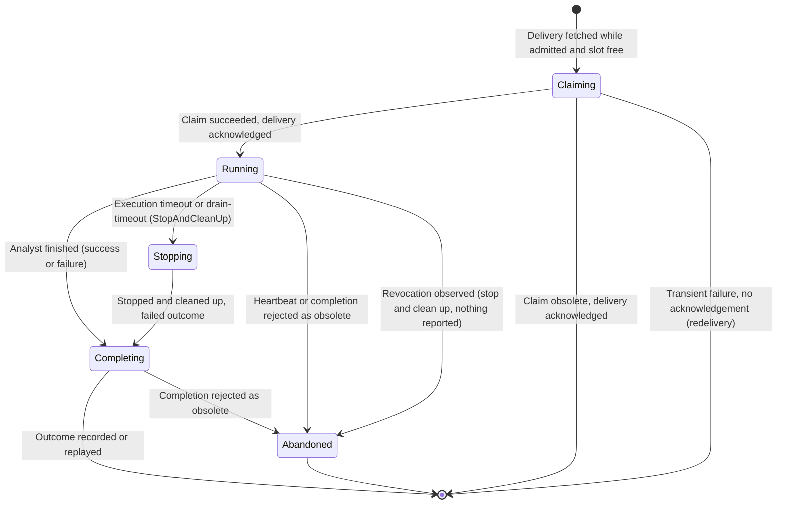

# Data Model: Analyst Manager Work Execution With a Simulated Analyst

## Platform (persistent)

### Issued queue credential

Table `registry.analyst_manager_queue_credential`, added by migration
`0014_registry_queue_credentials.sql`. It has no `version` column, so it is
classified in `PersistedTableClassifications.cs`.

| Column | Type | Rules |
| --- | --- | --- |
| `queue_credential_id` | uuid PK | |
| `registration_id` | uuid FK → registration | The Manager's registration |
| `user_public_key` | text, unique | NATS user NKey public key (`U…`); never a seed |
| `issued_at` | timestamptz | |
| `expires_at` | timestamptz | `issued_at` + configured lifetime |
| `revoked_at` | timestamptz null | Set by revocation or unregistration completion |
| `revocation_pushed_at` | timestamptz null | Set once NATS acknowledged the account JWT that contains the revocation |

Rules:

- Issued only while the registration is Active (FR-006).
- Revocation sets `revoked_at` for every row of the registration with
  `expires_at > now` in the same unit of work as the registration change and
  attempt fencing.
- The account JWT revocations are rebuilt from the rows with
  `revoked_at` set and `expires_at > now`.
- Rows with `expires_at` in the past may be deleted by the existing
  maintenance pattern, because NATS refuses expired JWTs anyway.

### Configuration (no persistence)

- `AnalystWork:MaxConcurrentAnalystsPerManager`: a positive integer. It is
  returned with credentials and is the stamp maximum in FR-019.
- `AnalystWork:QueueCredentialLifetime` and `AnalystWork:QueueUrl`: the public
  NATS URL for Managers.
- `AnalystWork:ConsumerAckWait`: the acknowledgement wait for the
  per-capability consumers.
- `Nats:Authentication`: `Mode` (`Jwt` or `None`), `OperatorSeed`,
  `AccountSeed`, `SystemAccountSeed`, and the stamp account public key. `None`
  is allowed only in Development and Test.

### Attempt fencing on revocation

This adds no new table. It reuses the attempt states of the durable analysis
workflow: an `Active` attempt of the revoked Manager becomes `Stale`, its token
is invalidated, budget is consumed, and the Logical Job becomes ready again or
fails permanently, all in one durable step (FR-023).

## Analyst Manager (in memory unless noted)

### Active attempt

| Field | Source |
| --- | --- |
| Logical Job id, readiness occurrence, message id | Delivery |
| Attempt id, attempt number, fencing token | Claim response |
| Lease duration, lease expiry, stale timeout, execution timeout | Claim response |
| Capability, pinned digests, resources | Delivery (job contract) |
| Execution state | `preparing`, `running`, `finalizing` (heartbeat contract) |
| Started at, last confirmed heartbeat | Manager clock and confirmed responses |
| Completion idempotency key | `completion:<attemptId>` |

The fencing token is never logged or persisted (FR-025, SC-008).

State machine (Manager view):

### Queue credential (Manager)

This record holds the ephemeral NKey pair (in memory only), the user JWT and
its expiry, the queue URL, the stream, the consumer per capability, the inbox
prefix, and `maxConcurrentAnalysts`. It is renewed at two thirds of its
lifetime and discarded on revocation, unregistration, or exit.

### Concurrency limit

- **Host-local limit**: a positive integer, default 1, persisted in the
  Manager's signed local state.
- **Effective limit**: `min(hostLocal, maxConcurrentAnalysts, runtime.MaxParallelAttempts)`.

### Simulated Analyst profile (Development and Test only)

This is the `Runtime:Simulated:Capabilities` configuration. Each entry has:

- a capability id;
- an outcome (`succeed`, `fail`, `hang`, `crash`);
- a run duration;
- a failure reason;
- a result reference and checksum.

At the runtime level, the profile also sets `MaxParallelAttempts`. Selecting
the `simulated` profile outside Development or Test refuses startup (FR-008).

### Status snapshot additions

- `activeAttempts[]`, with for each entry: Logical Job, attempt number,
  execution state, start time, and last confirmed heartbeat.
- `concurrency`: the host-local limit, the stamp maximum, the runtime maximum,
  and the effective limit.

See [local-control-active-attempts.md](contracts/local-control-active-attempts.md).
